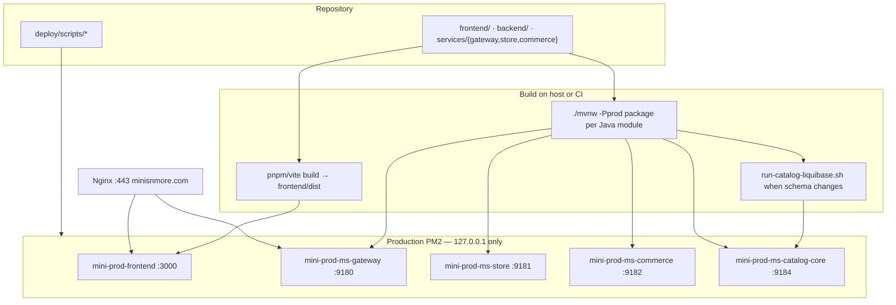
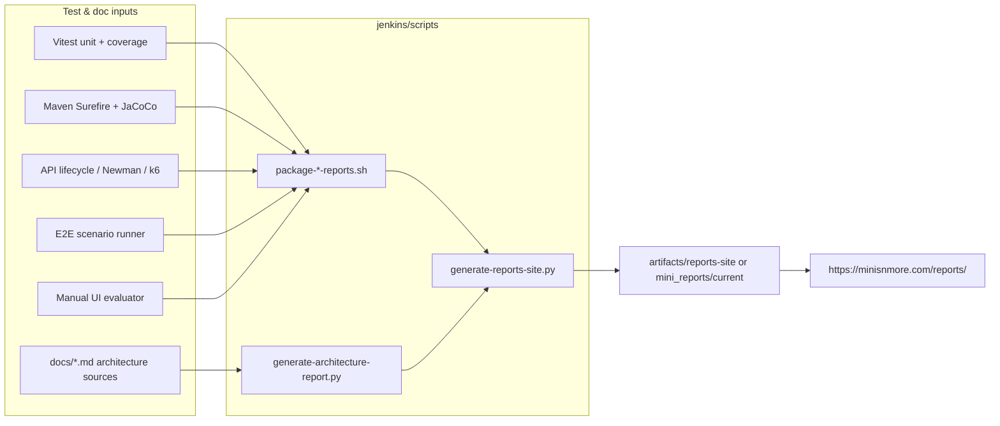

# CI/CD and reports pipeline

How code moves from this repository to **https://minisnmore.com** and the branded **Reports** dashboard (`/reports/`).

## Release and deploy (production)

- Isolated stack: Consul **off**, gateway profile `prod,uat-isolated`, fixed HTTP routes to `9181` / `9182` / `9184` (see [handover/architecture-diagram.md](./handover/architecture-diagram.md)).
- Cutover scripts: `deploy/scripts/prod-microservices-isolated-pm2.sh`, `prod-nginx-cutover-isolated.sh`, `health-check-microservices.sh`.

## Jenkins / QA reports bundle

| Script | Output |
| --- | --- |
| `generate-architecture-report.py` | `./architecture/` — interactive diagrams (Mermaid) from `docs/` |
| `generate-guidelines-report.py` | `./guidelines/` — API / DB / frontend / backend standards |
| `generate-reports-site.py` | `./index.html` — hub linking all sections |
| `publish-ledgerly-reports.sh` | Publishes to `/var/www/uat1/mini_reports/current` |

SonarQube, Swagger, and JavaDoc indices are wired from the same hub; see `jenkins/scripts/generate-reports-site.py`.
