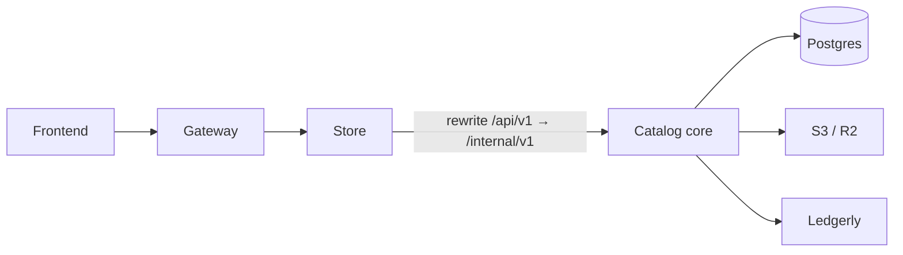

# How the catalog is managed

Internal guide for **`mini_ms_test`** (Mini’s n More): where product data lives, how storefront and admin use it, and how Ledgerly fits in.

> **Pricing, inventory sync, and Ledgerly field contracts** are defined authoritatively in  
> **[`docs/catalog-and-ledgerly-alignment.md`](./catalog-and-ledgerly-alignment.md)**. Prefer that doc over any older MRP↔rate notes below.

---

## One-sentence summary

**Catalog core** (`backend/`) owns products and categories in Postgres. The browser never talks to it directly — traffic goes **Gateway → Store → Catalog**. Ledgerly sync also runs **inside catalog core**.

---

## Services & ports

| Service | Directory | Port (prod / UAT isolated) | Owns catalog DB? |
|---------|-----------|----------------------------|------------------|
| Gateway | `services/gateway/` | `8080` / `9180` | No |
| Store (edge API) | `services/store/` | `8081` / `9181` | No |
| Commerce | `services/commerce/` | `8082` / `9182` | No |
| **Catalog core** | `backend/` | **`8084` / `9184`** | **Yes** |

- DB: Postgres database **`miniandmore`** (Liquibase runs **only** on catalog core).
- Store/commerce call catalog via `APPLICATION_CATALOG_BASE_URL` / `CATALOG_BASE_URL` (e.g. `http://127.0.0.1:8084`).

There is **no separate Zoho/Ledgerly integration microservice** for catalog sync anymore — Ledgerly lives in catalog core.

---

## Request flow

```text
Browser (Vite / React)
    → Gateway (:8080 / :9180)
    → Store (:8081 / :9181)     /api/v1/**
    → Catalog core (:8084 / :9184)   /internal/v1/**
```



**Proxy details**

| Piece | Path |
|-------|------|
| Store catch-all | `services/store/.../StoreCatalogProxyResource.java` |
| Path rewrite | `services/store/.../CatalogCoreClient.java` — `/api/v1/X` → `/internal/v1/X` |
| Exception | `/api/v1/admin/ledgerly/**` stays `/api/v1/admin/ledgerly/**` on catalog (not rewritten to `/internal`) |

---

## Storefront (read catalog)

**Core APIs** — `backend/.../InternalStorefrontResource.java`

| Browser calls | Catalog serves |
|---------------|----------------|
| `GET /api/v1/categories` | `GET /internal/v1/categories` |
| `GET /api/v1/products` | `GET /internal/v1/products` (active only) |
| `GET /api/v1/products/{slug}` | `GET /internal/v1/products/{slug}` |

**Frontend**

| Role | Path |
|------|------|
| Fetch / map | `frontend/src/lib/backend-data.ts`, `frontend/src/lib/storefront.ts` |
| Hook | `frontend/src/hooks/useProducts.tsx` |
| Shop / search | `frontend/src/routes/shop.tsx`, `frontend/src/lib/shop-filters.ts`, `frontend/src/lib/product-search.ts` |
| Header search | `frontend/src/components/Navbar.tsx` |

Today the storefront loads the **full active catalog** once, then filters/searches in the browser (category, age, fabric, free-text `?q=`).

---

## Admin (write catalog)

### UI

| Screen | Route | File |
|--------|-------|------|
| Products | `/admin/products` | `frontend/src/routes/admin.products.tsx` |
| Categories | `/admin/categories` | `frontend/src/routes/admin.categories.tsx` |
| Ledgerly | `/admin/integrations/ledgerly` | `frontend/src/routes/admin.integrations.ledgerly.tsx` |

### APIs

Core controller: `backend/.../InternalAdminStoreResource.java` (`/internal/v1/admin`).

| Action | Public path |
|--------|-------------|
| List / CRUD categories | `/api/v1/admin/categories[/{id}]` |
| List / CRUD products | `/api/v1/admin/products[/{id}]` |
| Image upload / presign | `/api/v1/admin/uploads`, `.../presign` |
| Ledgerly tools | `/api/v1/admin/ledgerly/**` (`LedgerlyAdminResource`) |

On product **save**, catalog schedules a Ledgerly **push**. On **delete**, it deactivates the Ledgerly item first (`notifyLedgerlyBeforeStoreDelete`), then removes the local row.

---

## Product data model

Entity: `backend/.../domain/Product.java` → table `product`.

| Area | Fields |
|------|--------|
| Identity | `id`, `slug` (unique), `sku` (unique), `name` |
| Pricing | `price` = **selling price** (storefront); `compare_at_price` = **MRP**; `currency` |
| Stock | `stock` (for `VARIANTS`, sum of active rows) |
| Content | `description`, `story`, `fabric_type`, `images_json`, `badge`, age min/max, flags (`featured`, `trending`, `new_arrival`, `best_seller`, `active`), `sort_order` |
| Options | `sizes_json`, `colors_json` |
| Variants | `item_structure` (`SIMPLE` \| `VARIANTS`), `variants_json` |
| Tax (DB) | `hsn`, `tax_pct` |
| Category | FK → `category` |
| Ledgerly | `ledgerly_item_id`, `ledgerly_sync_status`, `ledgerly_last_synced_at`, `ledgerly_sync_error` |

**Category** (`category`): `slug`, `name`, `description`, `image_url`, `sort_order`, `active`, `ledgerly_category_id`.

Frontend uses snake_case (`compare_at_price`, `item_structure`, `variants_json`, …) via `fromProductDto` / `toProductDto` in `frontend/src/lib/backend-data.ts`.

### Pricing naming (admin UI)

| UI label | DB / API field | Ledgerly (target contract) |
|----------|----------------|----------------------------|
| Selling price | `price` | Item **rate** |
| MRP | `compare_at_price` | Item **mrp** |

See the full pricing / inventory / sync tables in [`catalog-and-ledgerly-alignment.md`](./catalog-and-ledgerly-alignment.md).

---

## Variants

| Piece | Path |
|-------|------|
| Migration | `backend/.../liquibase/changelog/20260714150000_add_product_variants_and_order_item_variant_sku.xml` |
| Backend logic | `backend/.../ProductVariantSupport.java` |
| Admin matrix UI | `frontend/src/components/admin/VariantsMatrixEditor.tsx` |
| Storefront parse | `frontend/src/lib/product-variants.ts` |

- **`SIMPLE`**: one SKU / one price / one stock.
- **`VARIANTS`**: `variants_json` is a size × color matrix, e.g.

```json
[
  { "sku": "HORIZON-M-NAVY", "size": "M", "color": "Navy", "rate": 1299, "cost": 0, "stock": 4, "active": true }
]
```

- `rate` = MRP (synced to Ledgerly); storefront selling price is typically `rate × 0.80`.
- Parent `price`, `stock`, `sizes_json`, `colors_json` are rebuilt from the matrix.
- Checkout stores `order_item.variant_sku`; inventory reserve/return adjusts variant stock.

---

## Images

- Stored as **URLs** in `product.images_json` (not blobs in Postgres).
- Admin uploads via `POST /api/v1/admin/uploads` (or presign) → **S3-compatible** storage (Cloudflare R2 in prod/UAT).
- Config: `application.storage.s3.*` / env `S3_*` (or R2 equivalents).
- FE helper: `uploadAdminImage("products", file)` in `frontend/src/lib/backend-data.ts`.
- More detail: [`docs/product-images-and-ledgerly-sync.md`](./product-images-and-ledgerly-sync.md).

---

## Ledgerly’s role in the catalog

All commerce sync runs in **catalog core**.

| Direction | API (via Ledgerly gateway) | Typical trigger |
|-----------|----------------------------|-----------------|
| Product push | `POST /v1/integrations/commerce/products/sync` | Admin save; Sync products; deactivate on delete |
| Product pull | `POST /v1/integrations/commerce/products/pull` | Admin “Pull products” |
| Inventory pull | `POST /v1/integrations/commerce/inventory/pull` | Admin + hourly scheduler |
| Webhooks | `POST /internal/v1/ledgerly/webhooks` | `item.created` / `item.updated`, etc. |

| Piece | Path |
|-------|------|
| HTTP client | `backend/.../LedgerlyIntegrationClient.java` |
| Sync / merge | `LedgerlySyncService.java`, `LedgerlyProductMergeService.java` |
| Admin API | `LedgerlyAdminResource.java` |
| Settings | table `ledgerly_setting` + env `LEDGERLY_*` |

Deeper cutover / parity notes:

- [`docs/ledgerly-uat-cutover.md`](./ledgerly-uat-cutover.md)
- [`docs/mini_ms_test-ledgerly-parity-checklist.md`](./mini_ms_test-ledgerly-parity-checklist.md)

---

## Schema (Liquibase)

| Item | Path |
|------|------|
| Master | `backend/src/main/resources/config/liquibase/master.xml` |
| Changelogs | `backend/src/main/resources/config/liquibase/changelog/` |
| Product / category entities | `20260603061813_added_entity_Product.xml`, `…Category.xml` |
| Zoho → Ledgerly rename | `20260701130000_rename_zoho_to_ledgerly.xml` |
| Variants | `20260714150000_add_product_variants_and_order_item_variant_sku.xml` |
| JDL source | `backend/jdl/miniandmore-store.jdl` |

Store and commerce do **not** run Liquibase against the catalog DB.

---

## Key files (cheat sheet)

| Area | Path |
|------|------|
| Split overview | [`docs/catalog-microservice-split.md`](./catalog-microservice-split.md) |
| Pure MS rules | [`docs/pure-microservices.md`](./pure-microservices.md) |
| Product entity / DTO | `backend/.../domain/Product.java`, `.../dto/ProductDTO.java` |
| Storefront internal API | `backend/.../InternalStorefrontResource.java` |
| Admin internal API | `backend/.../InternalAdminStoreResource.java` |
| Store proxy | `services/store/.../StoreCatalogProxyResource.java`, `CatalogCoreClient.java` |
| Gateway routes | `services/gateway/src/main/resources/config/application.yml` |
| FE data layer | `frontend/src/lib/backend-data.ts`, `frontend/src/lib/storefront.ts` |
| Admin products | `frontend/src/routes/admin.products.tsx` |
| Deploy / ports | `deploy/scripts/prod-microservices-isolated-pm2.sh`, `deploy/nginx/*` |

---

## Operational notes

1. **Catalog is source of truth** for what the website sells; Ledgerly is the accounting/inventory counterpart.
2. After env changes (`LEDGERLY_*`, `S3_*`), restart **catalog core** with updated env (e.g. `pm2 restart …catalog-core --update-env`).
3. Prefer admin UI + Ledgerly sync tools over editing Postgres by hand.
4. For variants, always sync **variant SKUs** on order lines — never only the parent SKU.
