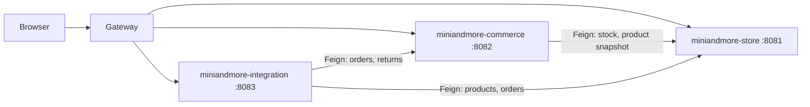

# Splitting the catalog into microservices

Today you have **gateway + one catalog** (`backend/`, service id `miniandmore`).  
This doc defines how to split catalog into **three** deployable services without changing the **public** `/api/v1/**` URLs (gateway keeps the same paths; only routing changes).

## Target topology

| Service | Consul id | Port (dev) | Database | Owns |
|---------|-----------|------------|----------|------|
| **Store** | `miniandmore-store` | 8081 | *(none — proxies core)* | Public `/api/v1/**` storefront + admin CMS + uploads → catalog core |
| **Commerce** | `miniandmore-commerce` | 8082 | *(none — proxies core)* | Orders, profile, coupons, payments, returns → catalog core |
| **Integration** | `miniandmore-integration` | 8083 | **shared** `miniandmore` | Zoho OAuth/settings, Zoho Books sync, schedulers (JPA read/write same schema as core) |
| **Catalog core** | `miniandmore` | 8084 | **shared** `miniandmore` | All domain logic at `/internal/v1/**`; Liquibase only here |

**Gateway** stays the only public entry (`:8080`). Frontend and `FRONTEND_API_CONTRACT.md` stay unchanged.

## Gateway routes (path-based)

Replace the single `miniandmore-api` route with:

| Path prefix | Service |
|-------------|---------|
| `/api/v1/admin/zoho/**`, `/api/v1/admin/zoho-settings` | `lb://miniandmore-integration` |
| `/api/v1/orders/**`, `/api/v1/account/**`, `/api/v1/payments`, `/api/v1/coupons/**`, `/api/v1/order-returns/**`, `/api/v1/admin/order-returns/**`, `/api/v1/admin/dashboard` | `lb://miniandmore-commerce` |
| Everything else under `/api/v1/**` | `lb://miniandmore-store` |

Order matters: more specific routes first in `application.yml`.

## Why not 22 microservices?

One service per “module” (products, blog, Zoho, …) would add heavy operational cost and chatter for little gain. **Three bounded contexts** match how the code is already grouped in v1 resources:

- `StorefrontResource` + content admin → **store**
- `AccountOrderResource`, `OrderReturnResource`, `AdminOrderReturnResource` → **commerce**
- `ZohoSyncResource` + `ZohoBooksSyncService` schedulers → **integration**

## Coupling to resolve when splitting

| From | To | Today | After split |
|------|-----|--------|-------------|
| Commerce | Product stock | Same DB / `Product` entity | Feign `POST /internal/v1/products/reserve` or event |
| Commerce | Site settings (GST, shipping) | `SiteSetting` in same app | Feign GET `/internal/v1/site-settings` (cache 1–5 min) |
| Commerce | Coupons | Same DB | Keep coupon master in **store**, validate via Feign or duplicate read-only replica |
| Integration | Products, categories | Repositories in one app | Feign to store |
| Integration | Orders | Repositories in one app | Feign to commerce |
| Returns | Refunds | Razorpay + order in commerce | Stays in commerce; Zoho credit note via integration |

`OrderItem` already stores `productId`, `productName`, … — good for commerce autonomy.

## JDL sources (JHipster generation)

| File | Entities |
|------|----------|
| `backend/jdl/miniandmore-store.jdl` | Category, Product, BlogPost, Banner, HomeSection, PageVisibility, SiteSetting, Policy, Coupon |
| `backend/jdl/miniandmore-commerce.jdl` | CustomerProfile, CustomerOrder, OrderItem, OrderReturn (+ enums) |
| `backend/jdl/miniandmore-integration.jdl` | ZohoSetting only |

Generate each with `jhipster jdl <file>.jdl` in its own folder (`store/`, `commerce/`, `integration/`), application type **microservice**, then port v1 controllers from current `backend/`.

## Phased rollout (recommended)

| Phase | Deliverable | Risk |
|-------|-------------|------|
| **0** (done in repo) | This doc + JDL splits + gateway route template | None |
| **1** | New **integration** service; move `ZohoSyncResource`, `ZohoBooksSyncService`, schedulers; Feign to catalog DB or read-only APIs | Medium |
| **2** | New **commerce** service; move orders/returns/profile; Feign store for stock + settings | High |
| **3** | Slim **store** service; drop order/zoho code from `backend/`; rename to `store/` | High |
| **4** | ~~Separate Postgres per service~~ **not planned** — keep one DB; integration owns Zoho code only | — |

## Phase 1 status (integration service) — done

`integration/` (`:8083`) exposes `/api/v1/admin/zoho/**` and `/api/v1/admin/zoho-settings` with **real** Zoho Books logic (shared Postgres, `spring.liquibase.enabled=false`). Catalog core triggers sync via `POST /internal/v1/zoho/triggers/**` (`ZohoBooksIntegrationClient`).

## Phase 2 status (commerce edge service) — done

`commerce/` (`:8082`) exposes orders, profile, coupons, payments, and order-returns (public paths unchanged). Catalog implements logic at `/internal/v1/**` (`InternalAccountOrderResource`, `InternalOrderReturnResource`, `InternalAdminOrderReturnResource`).

## Phase 3 status (store edge service) — done

`store/` (`:8081`) proxies all remaining public `/api/v1/**` (storefront, admin CMS, uploads) to catalog core at **`/internal/v1/**`**. Catalog core (`backend/`) listens on **:8084** only.

**Shared Postgres:** one schema (`miniandmore`), Liquibase on catalog core only. Zoho sync/schedulers run in **integration**; catalog calls integration for order sync, product sync, credit notes, and tracking pull.

## What stays in one service (optional)

If three services is too much ops, a **2-service** split is valid:

- **store** (content + public API + admin CMS)
- **commerce** (orders, returns, Zoho, uploads)

Zoho stays with commerce until a dedicated integration team needs isolation.

## Checklist per new service

- [ ] `skipUserManagement: true`, JWT validation only, no `JwtEncoder`
- [ ] No `/api/{entity}` CRUD; only `/api/v1` (+ optional `/internal/v1` for Feign)
- [x] Integration: shared Postgres, Liquibase disabled (core owns migrations)
- [ ] Edge services (store/commerce): no DB; proxy to core `:8084`
- [ ] Register in Consul; gateway route added
- [ ] `post-jhipster-cleanup.sh` equivalent per service
- [x] Jenkins: `BUILD_STORE`, `BUILD_COMMERCE`, `BUILD_INTEGRATION`, `DEPLOY_UAT` rsyncs all JARs to UAT1
- [ ] PM2 / nginx unchanged (still proxy to gateway only)

## Current status

**Split in progress:** gateway + store + commerce + integration edges; catalog core (`backend/`, `:8084`) holds commerce/store domain; integration holds Zoho Books. **No per-service Postgres.**

See also [pure-microservices.md](./pure-microservices.md), [microservices.md](./microservices.md).
