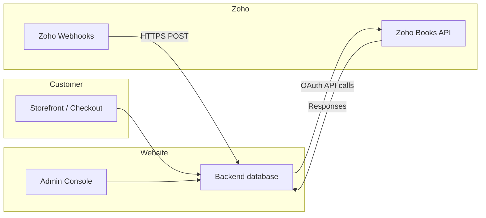

# Cover page

| | |
|---|---|
| **Document title** | Mini's n More — Website Administration, Business Operations & Zoho Integration Manual |
| **Version** | 1.0 |
| **Date** | 14 October 2026 |
| **Prepared for** | Mini's n More business and operations team |
| **Prepared by** | Delivery team (based on verified application code) |
| **Primary website (UAT)** | https://uat.minisnmore.com |
| **Primary website (Production)** | https://minisnmore.com |

**Confidentiality:** This document describes operational procedures. It does not contain passwords, API keys, or OAuth secrets.

---

## Revision history

| Version | Date | Author | Summary |
|---------|------|--------|---------|
| 1.0 | 14 Oct 2026 | Delivery team | Initial client handover manual from codebase audit |

---

## Table of contents

1. [Introduction and purpose](#chapter-1-introduction-and-purpose)
2. [Accessing the admin panel](#chapter-2-accessing-the-admin-panel)
3. [Admin dashboard overview](#chapter-3-admin-dashboard-overview)
4. [Website configuration and feature management](#chapter-4-website-configuration-and-feature-management)
5. [Product, SKU, and inventory operations](#chapter-5-product-sku-and-inventory-operations)
6. [Zoho integration and daily operations](#chapter-6-zoho-integration-and-daily-operations)
7. [Zoho setup, connection, and troubleshooting](#chapter-7-zoho-setup-connection-and-troubleshooting)
8. [Complete order lifecycle](#chapter-8-complete-order-lifecycle)
9. [Order cancellation procedure](#chapter-9-order-cancellation-procedure)
10. [Return management](#chapter-10-return-management)
11. [Exchange management](#chapter-11-exchange-management)
12. [Manual versus automated operations](#chapter-12-manual-versus-automated-operations)
13. [Exception handling and operational recovery](#chapter-13-exception-handling-and-operational-recovery)
14. [Daily, weekly, and monthly operations](#chapter-14-daily-weekly-and-monthly-operations)
15. [Roles, permissions, and approvals](#chapter-15-roles-permissions-and-approvals)
16. [Business rules and client decisions](#chapter-16-business-rules-and-client-decisions)
17. [Glossary](#chapter-17-glossary)
18. [Final handover checklist](#chapter-18-final-handover-checklist)
- [Appendix A — Technical escalation (for support tickets)](#appendix-a--technical-escalation-for-support-tickets)
- [Appendix B — Screenshot placeholders](#appendix-b--screenshot-placeholders)

---

# Chapter 1: Introduction and purpose

## 1.1 What this website does

Mini's n More is an e-commerce website for organic baby clothing and related products. Customers can:

- Browse the shop, search, and filter by category and age.
- Create an account, manage addresses, wishlist, and cart.
- Check out with **online payment (Razorpay)** or **Cash on Delivery (COD)**.
- Track orders and, when enabled, request **cancellations**, **returns**, or **exchanges** within configured policy windows.

Your team uses the **Admin Console** and related **staff desks** to manage catalog content, pricing, orders, fulfilment, refunds, and integration with **Zoho Books** (accounting and inventory items).

## 1.2 What you are responsible for

As an administrator or operations user, you are typically responsible for:

| Area | Examples |
|------|----------|
| **Merchandising** | Categories, products, images, coupons, homepage content |
| **Commerce settings** | Shipping fees, GST display, return window, contact details |
| **Orders** | Review new orders, packages, shipments, COD collection |
| **Post-order cases** | Approve/reject cancellations; manage returns and exchanges |
| **Zoho alignment** | Keep OAuth connected; run controlled product/inventory sync |
| **Customer issues** | Contact messages, support escalations |

## 1.3 What the system handles automatically

The following are **verified automated** behaviours (no button click required for each step):

- **Online payment:** Razorpay payment capture updates order payment status after successful verification.
- **Inventory reservation:** Stock is reserved when an order is placed; unreleased holds expire (online unpaid orders ~30 minutes).
- **Order sync to Zoho:** Paid orders trigger background sync to create/update Zoho Books contact, sales order, invoice, and payment (subject to connection health).
- **Tracking updates:** ExpressBees webhooks, Zoho shipment webhooks, scheduled Zoho tracking pulls (~15 minutes), and customer order-detail refresh can update tracking.
- **Emails:** Key milestones (e.g. out-for-delivery, delivery failed, delivered) send customer emails when carrier events occur.
- **Refunds (online):** Approved cancellations and completed returns can trigger Razorpay refunds automatically.
- **Zoho webhooks:** Invoice, shipment, order status, item, and stock events from Zoho update local records when secrets and payloads are correct.

## 1.4 What requires manual action

| Activity | Who |
|----------|-----|
| Approve/reject cancellation requests | Admin / Operations |
| Pack orders, create packages, book couriers | Operations |
| Mark COD collected | Admin / Operations |
| Approve returns/exchanges, book reverse pickup | Operations (support may approve/reject requests) |
| Inspect returned goods, accept/reject QC | Operations |
| Record COD refunds (method + reference) | Admin / Finance |
| Settle exchange price differences | Operations |
| Product merchandising and pricing | Admin |
| Zoho OAuth (re)connection | Admin (with Zoho org owner) |
| Reconciliation when sync fails | Operations + technical escalation |

## 1.5 How the website talks to Zoho

In simple terms:

1. **Your team** changes products or fulfils orders in the **Admin Console**.
2. The **website backend** stores data in its database and calls **Zoho Books API** (India data center by default).
3. **Zoho** can also **push updates** to the website using **webhooks** (stock, shipments, invoices, etc.).

A separate **Ledgerly** integration also appears in order/cancellation/return code paths. **Client confirmation required:** whether your live environment uses Ledgerly, Zoho, or both for accounting (see `CLIENT_CONFIRMATION_AND_GAPS.md`).

## 1.6 Who should use this manual

| Audience | Use |
|----------|-----|
| **Admin / Super Admin** | Full console: catalog, settings, Zoho, RBAC |
| **Operations** | Orders, shipments, returns, cancellations, invoices |
| **Customer Support** | Orders, customers, cases (limited fulfilment actions) |
| **Sales** | Product catalog view (`/sales/products`) |
| **Finance / Zoho owner** | Zoho OAuth, reconciliation, credit notes |

## 1.7 When to escalate to technical support

Escalate when:

- Admin login works but **Zoho Test connection** fails repeatedly.
- Orders are paid on the website but **missing in Zoho** after reasonable time.
- Refunds stuck in **FAILED** with gateway errors.
- Webhooks return **401** (secret mismatch) — requires server environment update, not admin UI.
- Entire admin or storefront unavailable.
- You are asked to edit database rows, environment files, or API code.

Provide: order number, case/return number, timestamps, screenshots, and current status fields (see Appendix A).

---

# Chapter 2: Accessing the admin panel

## 2.1 URLs

| Environment | Storefront | Staff login |
|-------------|------------|-------------|
| **UAT** | https://uat.minisnmore.com | https://uat.minisnmore.com/admin/login |
| **Production** | https://minisnmore.com | https://minisnmore.com/admin/login |

After login, **Admin** users land on **Dashboard** (`/admin`). Other staff roles are redirected to their desk (Operations, Sales, or Customer Support).

## 2.2 How to log in

**Purpose:** Access authorised back-office functions.

**Before starting:** You must have received a **staff invitation email** and completed account activation.

**Steps:**

1. Open **Staff sign in** at `/admin/login`.
2. Enter your **work email** and **password** (minimum 6 characters).
3. Click **Sign in**.
4. If you have **Admin** or **Super Admin** role, you will see the full Admin sidebar. Other roles go to their assigned desk.

> **Screenshot (verified UAT):** Staff login page — hero image, “Staff sign in”, email and password fields, **Sign in** button, **Forgot password?** link, **← Back to store**.
>
> *Capture during training:* `docs/client-handover/screenshots/01-admin-login.png`

## 2.3 How to log out securely

1. In the Admin sidebar (desktop) or mobile nav, click **Sign out**.
2. Close the browser tab if using a shared computer.
3. Do not share your password or leave an unlocked session unattended.

## 2.4 Password recovery

**Steps:**

1. On `/admin/login`, switch to **Forgot password** (or equivalent link on the form).
2. Enter your staff email and submit.
3. Use the link in your email to set a new password (customer reset flow also exists at `/reset-password` for storefront accounts).

If you do not receive email within 15 minutes, check spam and confirm the address matches your invitation. Escalate if the account is not **Active** in RBAC.

## 2.5 Permissions overview

| Role | Home after login | Access |
|------|------------------|--------|
| **Super Admin** | `/admin` | Full admin + can assign any staff role |
| **Admin** | `/admin` | Full admin; can assign Sales, Operations, Customer Support |
| **Operations** | `/operations/dashboard` | Orders, returns, cancellations, invoices, customers, products, contact messages |
| **Sales** | `/sales/products` | Products only |
| **Customer Support** | `/customersupport/orders` | Orders, customers, returns, cancellations, contact messages (fulfilment actions limited) |

**Important:** “Admin” in daily language means the **Admin Console** (`/admin`). Only **Super Admin** and **Admin** roles enter that console. Operations and Support use **separate URLs** with a similar look but narrower menus.

## 2.6 Administrator vs customer accounts

- **Customers** register on the storefront (`/login`) for shopping.
- **Staff** use the same authentication system but hold **ROLE_*** authorities** assigned in **RBAC** (`/admin/rbac`).
- A staff email should not be used as a personal shopping account without clarity on roles.

## 2.7 If the admin page does not load

1. Check internet connection and try the storefront homepage.
2. Confirm the correct hostname (UAT vs production).
3. Try another browser or clear cache.
4. If the whole site is down, escalate to technical support.

## 2.8 If access is denied (“Not authorised”)

1. Confirm you signed in with the intended email.
2. Ask a Super Admin to verify your role under **RBAC**.
3. If you are Operations but opened `/admin`, you will be redirected — use `/operations/dashboard` instead.

## 2.9 Security practices

- Use strong unique passwords.
- Do not share invitation links.
- Do not paste API secrets into **Policies**, **Blogs**, or product descriptions.
- Report suspected compromise immediately.

---

# Chapter 3: Admin dashboard overview

The left navigation is defined in the application (`Admin` sidebar). Use **Search pages…** to filter menu items quickly.

> **Screenshot placeholder:** Full Admin sidebar with Dashboard selected — label each nav item 1–n during live training.

## 3.1 Dashboard (`/admin`)

| | |
|---|---|
| **Used for** | High-level counts: categories, products, SKUs, coupons, blogs, pages, banners, policies; returns summary when post-order UI enabled |
| **Who** | Admin |
| **Actions** | Quick links to common areas |
| **After save** | Read-only overview |

## 3.2 Site settings (`/admin/settings`)

| | |
|---|---|
| **Used for** | Brand, contact, social links, footer, **GST**, **shipping**, **COD fee**, **return window**, refund policy days, e-catalogue PDF |
| **Who** | Admin |
| **Verify before save** | Phone/email accuracy; GST and shipping amounts; return window days |
| **Impact** | Storefront checkout totals, policy text, customer eligibility for returns |

## 3.3 Addresses (`/admin/addresses`)

Warehouse, dispatch, invoice, and registered office addresses used on documents and fulfilment.

## 3.4 Package types (`/admin/package-types`)

Box types and dimensions for packing and courier booking.

## 3.5 Contact messages (`/admin/contact-messages`)

Customer **Contact Us** submissions — read and follow up by email/phone outside the system if needed.

## 3.6 Banners (`/admin/banners`)

Homepage **hero carousel** slides (images, links, ordering).

## 3.7 Categories (`/admin/categories`)

Catalog navigation folders; products must reference a category.

## 3.8 Products (`/admin/products`)

Master catalog: SKUs, variants, prices, stock, images, Zoho push/pull per product.

## 3.9 Home sections (`/admin/home`)

Merchandising: shop-by-age, reviews, featured products, watch & shop reels.

## 3.10 About page (`/admin/about`)

Founders/story content for `/about`.

## 3.11 Gift page (`/admin/gift`)

Gifting landing content.

## 3.12 Page visibility (`/admin/pages`)

Show or hide storefront routes from navigation.

## 3.13 Coupons (`/admin/coupons`)

Promotional codes (including BOGO-style offers where configured).

## 3.14 Discount (`/admin/discount`)

Storewide percentage off MRP (interacts with product `compare_at_price`).

## 3.15 Blogs (`/admin/blog`)

Blog posts for `/blog`.

## 3.16 Policies (`/admin/policies`)

Legal and policy pages: terms, privacy, return, shipping.

## 3.17 Invoices (`/admin/invoices`)

GST invoice copy settings and related billing presentation.

## 3.18 Orders (`/admin/orders`)

Order list, detail, packages, shipments, COD, Zoho sync indicators, admin cancel when allowed.

## 3.19 Cancellations (`/admin/cancellations`)

Customer cancellation **requests** — approve, reject, record COD refund, retry failed refunds.

*Hidden if `VITE_SHOW_M2_POST_ORDER_UI` is false at build time.*

## 3.20 Returns & exchanges (`/admin/returns`)

Return and exchange cases — approve, pickup, inspect, refund, replacement shipment, exchange settlement.

## 3.21 Zoho settings (`/admin/zoho`)

OAuth connection, credentials, test connection, bulk pull/push products and inventory, order retry tools.

## 3.22 Customers (`/admin/customers`)

Registered buyers — search, view join date; link to RBAC for staff.

## 3.23 RBAC (`/admin/rbac`)

Invite staff, assign roles, resend invites, deactivate users.

---

# Chapter 4: Website configuration and feature management

This chapter uses a standard procedure template for major tasks.

---

## 4.1 Update contact details and social links

**Purpose:** Keep footer, contact page, and WhatsApp links correct.

**Before starting:** Admin role; approved marketing copy.

**Steps:**

1. Open **Site settings** (`/admin/settings`).
2. Expand **Contact** (or use section toggles).
3. Update **Contact email**, **Contact phone**, **WhatsApp number**, and social URLs.
4. Click **Save**.
5. Open the storefront footer and **Contact Us** to verify.

**Expected result:** New details visible on the live site within minutes.

**Impact:** Customers and courier SMS/email may use these values.

**Common mistakes:** Wrong country code on phone; http vs https on social URLs.

---

## 4.2 Configure shipping, GST, and COD fee

**Purpose:** Control checkout totals.

**Steps:**

1. **Site settings** → **Pricing** section.
2. Set **GST rate**, whether prices include GST, **standard/express shipping** amounts, **free shipping minimum**, and **COD handling fee**.
3. Save and place a **test cart** (on UAT) to verify totals.

**Impact:** Every new checkout; does not change already-placed orders.

---

## 4.3 Configure return window and refund policy text

**Purpose:** Control how many days after delivery customers may request returns/exchanges.

**Steps:**

1. **Site settings** → **Returns** section.
2. Set **Return window (days)** (default **3**, max **90**).
3. Set **Refund min/max business days** for customer-facing policy copy.
4. Save.

**Impact:** Eligibility API and account returns page use these values.

**Client confirmation required:** Align with legal return policy in **Policies** editor.

---

## 4.4 Create a category

**Purpose:** Organise products in the shop menu.

**Steps:**

1. Open **Categories** (`/admin/categories`).
2. Click add/new (or edit existing).
3. Enter **name**, **slug** (URL segment), optional image and description.
4. Set **active** and sort order if shown.
5. Save and confirm category appears on `/shop`.

**Impact:** Products require a valid category.

---

## 4.5 Create or edit a product (summary)

See **Chapter 5** for full SKU/inventory detail.

**Required fields (marked * in UI):** Name, Category, SKU, Fabric type, Selling price, Stock, Age range.

**Steps:**

1. **Products** → **New product** or select existing.
2. Complete required fields; upload images.
3. For **variant** products, use the variant matrix (prints × sizes); parent price/stock become read-only sums.
4. Save.
5. Optional: **Push to Zoho** from product actions when SKU is set.

**Impact:** Storefront visibility controlled by **active** flag; stock affects sellability.

---

## 4.6 Homepage banners

**Purpose:** Promote campaigns on the hero carousel.

**Steps:**

1. **Banners** (`/admin/banners`).
2. Add slide image, headline, link target, sort order.
3. Save and review homepage carousel.

---

## 4.7 Coupons and storewide discount

| Tool | Path | Effect |
|------|------|--------|
| **Coupons** | `/admin/coupons` | Code customer enters at checkout |
| **Discount** | `/admin/discount` | Percent off MRP across catalog |

Verify interaction: selling price may be derived from MRP minus storewide discount when `compare_at_price` is set.

---

## 4.8 Policies

**Purpose:** Legal and customer-facing policy pages.

**Steps:**

1. **Policies** (`/admin/policies`).
2. Edit **Terms**, **Privacy**, **Return**, **Shipping** content.
3. Save and open public URLs (`/terms`, `/privacy`, etc.).

**Warning:** Do not paste secrets or internal URLs with tokens.

---

## 4.9 Invite a staff member

**Purpose:** Grant controlled back-office access.

**Before starting:** Super Admin or Admin role.

**Steps:**

1. Open **RBAC** (`/admin/rbac`).
2. Enter first name, last name, email, **role**.
3. Click **Send invitation**.
4. Ask the user to complete the invite link and set password.
5. Confirm **Active** status in the staff table.

**Impact:** Role determines which desk and actions they see.

**Common mistakes:** Assigning Admin when Operations was intended (over-broad access).

---

## 4.10 Manage orders (Operations desk)

**Purpose:** Fulfil customer orders from payment through delivery.

**Before starting:** Operations or Admin role; understand difference between **cancel shipment** and **cancel order** (Chapter 9).

**Steps:**

1. Open **Orders** (`/admin/orders` or `/operations/orders`).
2. Use filters: payment status, order status, tracking status (including **ExpressBees cancelled** when courier voids AWB).
3. Open an order row to expand detail.
4. Verify **payment**: for COD with `PENDING` payment, collect cash/UPI on delivery then use **Mark COD collected**.
5. Create **package** when items are packed (**Create package** dialog) — contributes to **hand-wrapped** state when Zoho package exists.
6. **Book shipment** — ExpressBees (API) or manual carrier; enter AWB when manual.
7. Monitor tracking until **delivered**; handle **carrier_cancelled** by rebooking or cancelling order.
8. If **pending cancellation** banner appears, resolve on **Cancellations** before booking new shipment (unless audited override by technical process).

**Expected result:** Customer sees tracking progress on account; order reaches **FULFILLED** on delivery.

**Impact:** Zoho shipment webhooks update tracking; inventory already reserved at order time.

**Common mistakes:** Booking AWB before inventory confirmed; cancelling shipment thinking it refunds customer.

---

## 4.11 Bulk product CSV import

**Purpose:** Load many products at once.

**Before starting:** Categories must exist; backup current catalog before large imports on production.

**Steps:**

1. **Products** → import / CSV template (download template from UI if offered).
2. Required columns include: `slug`, `name`, `sku`, `category_slug`, `price`, `age_range`, `fabric_type`, `stock`, `active`.
3. Upload file and review validation errors.
4. Fix rows and re-import failed lines only.
5. Spot-check 3 SKUs on storefront and Zoho.

**Impact:** Incorrect SKUs break Zoho stock webhooks.

---

## 4.12 Blogs, gift page, home sections, page visibility

| Page | Path | Operational note |
|------|------|------------------|
| Blogs | `/admin/blog` | Publish date and slug affect `/blog/{slug}` |
| Gift page | `/admin/gift` | Marketing content only |
| Home sections | `/admin/home` | Controls curated homepage modules |
| Page visibility | `/admin/pages` | Hiding a page removes nav links — does not delete routes |

---

## 4.13 Invoices (GST presentation)

**Purpose:** Company legal name, CIN, registered address on downloadable invoices.

**Steps:** `/admin/invoices` → update copy → download sample invoice from an order (`/admin/orders/{orderNumber}/invoice`).

---

## 4.14 Customer account management

**Purpose:** View registered customers (not staff).

**Steps:** `/admin/customers` → search email → view profile timeline. For staff accounts use **RBAC**, not Customers.

---

# Chapter 5: Product, SKU, and inventory operations

## 5.1 Concepts

| Term | Meaning |
|------|---------|
| **Product** | What customers see on the shop (one page per style) |
| **SKU** | Unique stock-keeping code (parent SKU for simple products; variant SKUs for each size/colour combo) |
| **Variant** | Size and colour combination with its own SKU, price, and stock |
| **Stock** | Quantity available to sell on the **website database** |
| **Active** | If off, product hidden from shop but history preserved |

## 5.2 Source of truth (verified)

| Data | Primary on website | Synced to Zoho |
|------|-------------------|----------------|
| Merchandising (name, description, images) | Admin catalog | Push/pull |
| Selling price / MRP | Admin (variant matrix) | Push/pull |
| Stock on hand | Admin + order reservations | Pull inventory, stock webhook, push on change |
| Orders | Website | Zoho sales order / invoice |

**Client confirmation required** when Ledgerly is enabled in your deployment (may override pull direction).

## 5.3 Worked example (fictional)

**Product:** “Blush Petal Bodysuit”  
**Parent SKU:** `MNM-BPB-001`  
**Variant:** Size `6-12M`, Print `Rose` → SKU `MNM-BPB-001-6M-ROSE`, stock `25`, price `₹899`

**Steps to launch:**

1. Create category `bodysuits`.
2. Create product with required fields, set structure to **variants**, add size/colour rows.
3. Upload images; set **active** on.
4. **Push to Zoho** (or pull from Zoho if item already exists there).
5. Verify on `/shop` and in Zoho Books **Items**.

## 5.4 Out of stock

- Set variant or simple product stock to **0** — checkout should block or show unavailable.
- Prefer **active off** to delist discontinued styles instead of deleting SKUs with order history.

## 5.5 After orders are placed

- Changing price does not alter past orders (lines are snapshotted).
- Stock was reserved at order time; cancellations and returns restore stock per workflow rules.

## 5.6 Verifying Zoho inventory

1. Open product in **Admin → Products** — note SKU and stock.
2. In Zoho Books, open the matching **Item** by SKU.
3. After **Pull inventory** on `/admin/zoho`, website stock should match Zoho `stock_on_hand` for that SKU.
4. If mismatch persists, check recent orders (reserved stock) and webhook health (Chapter 7).

---

# Chapter 6: Zoho integration and daily operations

## 6.1 Which Zoho product is used

The application integrates with **Zoho Books API v3** (India host: `zohoapis.in`). It does **not** call Zoho CRM or a separate Zoho Inventory API as the primary integration path. Inventory-related features are modelled through **Books items** and webhooks.

## 6.2 Business explanation

Zoho Books holds your **items (SKUs)**, **customer contacts**, **sales orders**, **invoices**, **payments**, and **credit notes**. The website:

- **Pushes** catalog changes you make in Admin.
- **Pulls** catalog and stock when you request it.
- **Creates** sales documents when customers pay.
- **Receives webhooks** when your team updates fulfilment or stock in Zoho.

## 6.3 Data flow diagram

**Legend:**

- **Saved on website** = row exists in database.
- **Sent to Zoho** = API call returned success (check sync fields on order/product).
- **Confirmed in Zoho** = you can open the record in Zoho Books UI.
- **Synchronized** = website and Zoho agree on IDs/status (may still need webhook for shipment).

## 6.4 Entity reference

| Entity | Created by | Sync mechanism | Admin verification |
|--------|------------|----------------|-------------------|
| **Items / SKUs** | Admin or Zoho | Push product, pull products, item webhook | Product row Zoho id; Books → Items |
| **Stock** | Both | Stock webhook, pull inventory, order reservation | Compare SKU stock |
| **Customer contact** | Website on order | Order sync | Zoho contact linked to order |
| **Sales order** | Website | Order sync + webhooks | Order detail Zoho fields |
| **Invoice / payment** | Website / Zoho | Order sync, invoice webhook | Invoice admin + Zoho |
| **Credit note** | Website on return | Return refund action | Zoho credit note id on case |
| **Shipment / delivery** | Zoho / ExpressBees | Shipment webhook, carrier | Tracking on order |

## 6.5 Admin Zoho page actions (`/admin/zoho`)

| Action | When to use |
|--------|-------------|
| **Save credentials / Connect** | Initial setup or token expiry |
| **Test connection** | Daily health check |
| **Sync all products to Zoho** | New catalog on website — off-peak only |
| **Pull products from Zoho** | Zoho edited items — default incremental |
| **Pull inventory** | Refresh all stock from Zoho |
| **Retry failed orders** | Orders with sync errors |
| **Pull order tracking** | Manual refresh when webhooks delayed |

**Warning:** Long jobs may take **several minutes**. Do not refresh until the UI reports completion or failure.

## 6.6 Per-product Zoho actions

On **Products**, for each row:

- **Push** — requires SKU; sends item to Books.
- **Pull** — requires Zoho item id or SKU.

Variant products: pull/push at variant level where applicable.

## 6.7 Zoho webhooks (inbound from Zoho)

Zoho sends HTTPS POST requests to the website when events occur. Operations staff do not configure these in admin UI — the Zoho org administrator and technical team maintain them. You should know what they **do**:

| Webhook type | Business effect when working |
|--------------|------------------------------|
| **Invoice** | Updates local invoice/payment/void state when invoice paid or voided in Zoho |
| **Shipment** | Updates tracking; **delivered** from shipment fulfilled — not from invoice alone |
| **Sales order status** | Accounting states (invoiced, void, cancelled); **fulfilled** on sales order alone does **not** mark customer delivered |
| **Item** | Refreshes one product when item edited in Zoho |
| **Stock** | Sets website stock for SKU to Zoho `stock_on_hand` |

**Operational rule:** Trust **shipment fulfilled** for delivery to customer, not sales-order fulfilled from invoicing.

Production webhook URL paths (for Zoho admin reference only):

- Invoice: `https://minisnmore.com/api/v1/zoho/invoice-webhook`
- Stock: `https://minisnmore.com/api/v1/zoho/stock-webhook`
- Shipment / order status / item: under `/internal/v1/zoho/...` (gateway)

UAT hosts need matching URLs in Zoho if testing webhooks on UAT.

## 6.8 Scheduled jobs (background)

| Job | Typical frequency | Effect |
|-----|-------------------|--------|
| Zoho order sync retry | On failure / schedule | Pushes stuck orders |
| Zoho tracking pull | ~15 minutes | Updates shipment state |
| Unpaid order release | ~30 min hold | Cancels unpaid online orders |

Disabling `ZOHO_AUTO_SYNC_ENABLED` or `ZOHO_ORDER_TRACKING_ENABLED` in server config stops schedulers — **webhooks still work**. This is technical configuration, not an admin toggle.

## 6.9 Record saved vs synchronized (checklist)

When training staff, use this checklist on one test order:

1. [ ] Order visible in **Orders** with correct lines and total.  
2. [ ] `payment_status` = PAID (or PENDING for COD).  
3. [ ] Zoho Books shows **sales order** with same reference/SKU lines.  
4. [ ] Invoice exists and matches amount (may lag seconds/minutes).  
5. [ ] After shipment in Zoho, website tracking shows **On the way** / **Delivered**.  

If step 3 fails but step 1 succeeds, the website record exists but is **not synchronized** — use retry tools (Chapter 7).

---

# Chapter 7: Zoho setup, connection, and troubleshooting

## 7.0 Initial Zoho connection (admin steps)

**Purpose:** Allow the website to read and write Zoho Books on your organisation's behalf.

**Before starting:** Zoho Books organisation ID; API client created in Zoho API console; redirect URL whitelisted (`https://minisnmore.com/admin/zoho` for production).

**Steps:**

1. Open **Zoho settings** (`/admin/zoho`).
2. Enter **Org ID** (6–15 digits), **Client ID**, **Client secret** (first time only), **Data center** (India = `in`).
3. Click **Save**.
4. Click **Connect to Zoho Books** — sign in as Zoho org admin and approve access.
5. On return, page should show connected state.
6. Click **Test connection** — toast should show organisation name.
7. Do **not** run full catalog pull until agreed (Chapter 6).

**Expected result:** `connected: true` and test succeeds.

**Never** paste client secret or refresh token into email or this manual.

## 7.1 Who does what

| Task | Business admin | Zoho org admin | Technical support |
|------|----------------|----------------|-------------------|
| Connect OAuth on `/admin/zoho` | ✓ | Assists with API console | |
| Create Zoho API client + redirect URL | | ✓ | ✓ |
| Set webhook secrets in server | | | ✓ |
| Retry order sync in admin | ✓ | | |
| Fix nginx/gateway routing | | | ✓ |

## 7.2 Connection symptoms

| Symptom | Likely cause | Safe admin action |
|---------|--------------|-------------------|
| Test connection fails | Expired token, wrong org id | Re-connect OAuth |
| 401 on webhooks | Secret mismatch | Escalate — do not change prod env yourself |
| Product pull stops mid-way | Zoho rate limit (429) | Wait 15–60 min; retry smaller scope |
| Order not in Zoho | Sync failed at checkout | Use order retry tools; note error message |

## 7.3 Reconciliation checklist

1. Find website order number.
2. Note `zoho_sync_status` / error on order detail (admin).
3. Search Zoho Books for sales order by reference or customer.
4. If duplicate exists, **stop** and escalate — do not create manual duplicate orders.
5. Document event ids from webhook tables (technical team) if repeats occur.

## 7.4 SKU mapping issues

- SKU on website must match Zoho item SKU for stock webhooks.
- Variant products need SKU on each variant row.

---

# Chapter 8: Complete order lifecycle

## 8.1 Four related status layers

1. **Order status** (`status`) — fulfilment milestone on the order.
2. **Payment status** (`payment_status`) — money collected or refunded.
3. **Tracking status** — customer-facing delivery progress (computed).
4. **Return / cancellation case status** — separate records.

## 8.2 Order status values

| Status | Meaning |
|--------|---------|
| `PENDING` | Placed; awaiting online payment |
| `CONFIRMED` | Accepted for fulfilment |
| `HAND_WRAPPED` | Package exists (Zoho package / hand-wrap signal) |
| `FULFILLED` | Delivered / complete |
| `CANCELLED` | Order cancelled |

## 8.3 Payment status values

| Status | Meaning |
|--------|---------|
| `PENDING` | Not paid (or COD not collected) |
| `PAID` | Payment received |
| `FAILED` | Online payment failed |
| `REFUNDED` | Refund completed |

## 8.4 Tracking status (customer labels)

| Internal | Customer sees |
|----------|----------------|
| `pending` | Awaiting payment |
| `confirmed` | Order confirmed |
| `hand_wrapped` | Hand-wrapped |
| `awaiting_pickup` | Waiting for pickup |
| `shipped` | On the way |
| `out_for_delivery` | Out for delivery |
| `delivery_failed` | Delivery attempt unsuccessful |
| `delivered` | Delivered |
| `cancelled` | Cancelled |

## 8.5 State transition table (order status)

| From | To | Trigger | Auto / manual |
|------|-----|---------|---------------|
| — | PENDING | Online checkout placed | Auto |
| — | CONFIRMED | COD placed or payment verified | Auto |
| CONFIRMED | HAND_WRAPPED | Package created | Manual ops / Zoho package webhook |
| HAND_WRAPPED | FULFILLED | Delivered signal | Webhook / carrier |
| * | CANCELLED | Approved cancellation or admin cancel | Manual approve / admin |
| PENDING | CANCELLED | Payment timeout / release | Auto |

**Prohibited:** Cancelling after AWB booked (must use returns). Do not set delivered from invoice-paid alone — shipment proof required.

## 8.6 Customer vs admin view

- Customers see tracking + payment summary on **Account → Orders** and **Track order**.
- Admins see sync fields, package tools, and action buttons on **Orders**.

---

# Chapter 9: Order cancellation procedure

## 9.1 Decision table

| Order state | Payment | Customer action | Admin action |
|-------------|---------|-----------------|--------------|
| Confirmed, no AWB | Paid online | Request cancel | Approve → auto Razorpay refund + cancel |
| Confirmed, no AWB | COD not collected | Request cancel | Approve → cancel (no refund) |
| Confirmed, no AWB | COD collected | Request cancel | Approve → cancel + **record COD refund** |
| AWB booked or later | Any | Request blocked | Direct to returns if delivered |
| Any eligible | Paid | — | **Cancel order** on Orders if flags allow |

## 9.2 A. Customer requests cancellation

1. Customer submits request from account (creates **REQUESTED** case).
2. Open **Cancellations** (`/admin/cancellations` or Operations desk).
3. Search by order number or date.
4. Verify payment and tracking (no AWB yet).
5. **Approve** — system cancels order, restores stock, syncs Zoho/Ledgerly, refunds Razorpay if paid online.
6. **Reject** — enter reason (min 5 characters); customer notified; fulfilment continues.
7. For COD with cash already collected, use **Record COD refund** after approval.

## 9.3 B. Admin initiates cancellation

On **Orders**, use **Cancel order** when `can_admin_cancel` is true. Provide reason (min 5 characters). If ExpressBees AWB is live, you may need to void shipment as part of the flow.

## 9.4 C. Already shipped or delivered

Cancellation is **not** supported. Use **Returns & exchanges** (Chapter 10–11) if within return window.

## 9.5 D. Payment collected

- **Online:** Refund tied to approval; retry available if FAILED.
- **COD:** Manual record of refund method and reference.

## 9.6 E. Zoho sync failure on cancel

1. Confirm order shows **CANCELLED** locally.
2. Check Zoho sales order status.
3. Use retry tools or escalate with order number — do not duplicate orders in Zoho manually without guidance.

## 9.7 Shipment cancel (not order cancel)

**Cancel shipment** voids courier booking only. Order stays open for rebook or separate cancellation workflow.

---

# Chapter 10: Return management

## 10.1 Customer submission

1. Customer opens eligible delivered order in account. Eligibility uses the **physical delivery time** (`shipment_delivered_at`), not the dispatch date.
2. Selects items/quantities and reason.
3. Case created as **REQUESTED**.

## 10.2 Admin procedure

1. Open **Returns & exchanges** (`/admin/returns`).
2. Filter **Returns**; locate case.
3. Review photos/notes if provided.
4. **Approve** or **Reject** (reason to customer).
5. Book **reverse pickup** (ExpressBees or manual/self-ship). The customer sees the pickup AWB and a **Track pickup** link on **Account → order detail** and **Returns & exchanges**.
6. Monitor pickup milestones → **RECEIVED** at warehouse.
7. **Inspect** → **Accept** or reject QC (partial quantities supported).
8. **Refund** — triggers Razorpay for online; COD refund recording for cash orders.
9. Confirm case **REFUNDED** and order `payment_status` updated.
10. Verify **credit note** in Zoho/Ledgerly via technical checklist.

## 10.3 Return case status path (verified)

`REQUESTED` → `APPROVED` → `PICKUP_SCHEDULED` → `PICKED_UP` → `RECEIVED` → `INSPECTED` → `ACCEPTED` → `REFUNDED`

Branches: `REJECTED`, `PICKUP_FAILED`, `FAILED` (refund retry), `CANCELLED` (customer withdraws while REQUESTED).

---

# Chapter 11: Exchange management

## 11.1 Customer submission

Select order line, replacement size/colour, reason. System validates variant availability and no duplicate open case.

## 11.2 Approval and price difference

On **Approve**, replacement stock is **reserved**. Settlement:

| Difference | Action |
|------------|--------|
| Replacement more expensive | Collect difference before outbound |
| Cheaper | Refund difference (Razorpay or manual) |
| Same | No settlement |
| Waived | Manager override (confirm policy) |

Outbound booking blocked while settlement **PENDING**.

## 11.3 Fulfilment path

`ACCEPTED` → `ITEM_ALLOCATED` → `REPACKING` → `READY_TO_SHIP` → `SHIPPED` → `DELIVERED` → `COMPLETED`

## 11.4 Scenarios

| Scenario | Handling |
|----------|----------|
| Replacement OOS | Convert exchange to refund |
| Pickup failed | Reschedule or close case |
| Inspection fail | Reject or partial accept per policy |
| Replacement shipment | Book outbound AWB; customer sees outbound tracking link |

Original order remains **delivered** in tracking — show exchange case status separately to customers.

---

# Chapter 12: Manual versus automated operations

| Activity | Trigger | Automatic action | Admin action | Zoho action | Verification | Escalation |
|----------|---------|------------------|--------------|-------------|--------------|------------|
| Place order | Customer checkout | Reserve stock, create order | — | Sync queued on payment | Order in admin | Sync failure |
| Online payment | Razorpay | Mark PAID, CONFIRMED | — | Sales order pipeline | Payment status | Gateway down |
| COD order | Customer | CONFIRMED, payment PENDING | Collect cash on delivery | Sync per rules | Mark COD collected | — |
| Package / hand-wrap | Ops / Zoho | Status HAND_WRAPPED | Create package in admin | Package webhook | Tracking label | — |
| Book ExpressBees | Ops | AWB, awaiting_pickup | Book in UI | — | AWB on order | Courier API error |
| Shipped / delivered | Carrier/Zoho | Tracking emails, FULFILLED | — | Shipment webhook | Customer track page | Missing webhook |
| Cancel request | Customer | Holds shipment booking | Approve/reject | Cancel sync | Cancelled status | Refund FAILED |
| Return refund | Ops accept | Razorpay refund, stock restore | Inspect, refund click | Credit note | REFUNDED case | FAILED retry |
| Exchange ship | Ops | Notifications | Book outbound | Stock push may run | COMPLETED | Settlement pending |
| Product push | Admin | API to Books | Click push | Item updated | SKU in Zoho | 429 quota |
| Pull inventory | Admin schedule | Overwrite local stock | Run pull | Read all items | Spot-check SKUs | Partial pull |
| Stock webhook | Zoho | Update SKU qty | — | Webhook POST | Stock match | 401 secret |

Classifications: **AUTOMATED**, **MANUAL**, **PARTIALLY AUTOMATED** as indicated in columns.

---

# Chapter 13: Exception handling and operational recovery

## 13.1 Admin cannot log in

| Step | Action |
|------|--------|
| 1 | Verify email/password; use forgot password |
| 2 | Check RBAC — account **Active**? |
| 3 | Confirm correct site (UAT vs prod) |
| Escalate | If activated but still fails |

## 13.2 Product not on website

Check **active** flag, category, stock > 0, page visibility, cache (hard refresh).

## 13.3 Wrong price or stock

Edit product or variant; run controlled Zoho pull; check storewide discount.

## 13.4 Order missing in admin

Search by order number; check filters; verify environment.

## 13.5 Payment vs order mismatch

Compare `payment_status` and Razorpay dashboard; use sync-payment tools (technical) if provided on order.

## 13.6 Order in website but not Zoho

Retry sync from Zoho page or order detail; capture error text; escalate.

## 13.7 Return/exchange stuck

Identify case status; check settlement pending, pickup failed, or refund FAILED; use retry actions in UI.

## 13.8 Customer no email

Check spam; verify contact email on order; escalate if mail service down.

## 13.9 Escalation information checklist

- [ ] Order number / return number / cancellation request id  
- [ ] Timestamp (IST)  
- [ ] Current `status`, `payment_status`, tracking  
- [ ] Zoho sales order / invoice id if known  
- [ ] Screenshot of admin error toast  
- [ ] Steps already attempted  

**Do not send:** passwords, full card numbers, webhook secrets.

---

# Chapter 14: Daily, weekly, and monthly operations

## 14.1 Daily (recommended)

- [ ] New orders — confirm payment and address  
- [ ] **REQUESTED** cancellations and returns  
- [ ] Orders awaiting shipment booking  
- [ ] ExpressBees / carrier exceptions (`delivery_failed`, `carrier_cancelled`)  
- [ ] Zoho **Test connection** if prior failures  
- [ ] Contact messages inbox  

## 14.2 Weekly (recommended)

- [ ] Sample reconciliation: 5 orders website ↔ Zoho  
- [ ] Inventory spot-check high-velocity SKUs  
- [ ] Review refund FAILED cases  
- [ ] Review inactive products still receiving traffic  

## 14.3 Monthly (recommended)

- [ ] RBAC audit — remove leavers  
- [ ] Review return window vs policy text  
- [ ] Review coupon usage and expired codes  
- [ ] Confirm OAuth still valid (no surprise expiry)  

*These checklists are operational controls — not all have automated reminders in the app today.*

---

# Chapter 15: Roles, permissions, and approvals

| Role | Catalog | Orders fulfil | Cancel approve | Return refund | Zoho bulk | RBAC |
|------|---------|---------------|----------------|---------------|-----------|------|
| Super Admin | ✓ | ✓ | ✓ | ✓ | ✓ | All roles |
| Admin | ✓ | ✓ | ✓ | ✓ | ✓ | Sub-roles |
| Operations | View/edit products | ✓ | ✓ | ✓ | Limited | — |
| Customer Support | — | View; limited ship | Approve/reject* | Limited* | — | — |
| Sales | Products | — | — | — | — | — |

\*Support desk: fulfilment flags off for some actions (`canFulfill` false) — booking shipments may require Operations.

**Proposed control (client approval):** Manager sign-off for WAIVED exchange differences and high-value refunds.

---

# Chapter 16: Business rules and client decisions

See dedicated register: **`CLIENT_CONFIRMATION_AND_GAPS.md`**.

Summary of highest priority decisions:

1. Return window days vs marketing copy  
2. Ledgerly vs Zoho ownership for orders and stock  
3. COD refund authority  
4. Cancellation after hand-wrap  
5. Escalation contacts and SLAs  

---

# Chapter 17: Glossary

| Term | Plain English |
|------|----------------|
| **Admin panel** | Password-protected back-office (Admin Console at `/admin`) |
| **SKU** | Unique product code used for inventory and Zoho items |
| **Inventory / stock** | How many units you can sell |
| **Order status** | Internal fulfilment stage (confirmed, shipped, etc.) |
| **Payment gateway** | Razorpay — processes online card/UPI payments |
| **Refund** | Money returned to customer |
| **Return** | Customer sends product back for refund |
| **Exchange** | Customer swaps for another variant/product |
| **API** | Machine interface between website and Zoho (you use buttons, not APIs) |
| **Webhook** | Zoho automatically notifying the website when something changes |
| **Synchronization** | Making website and Zoho agree on data |
| **OAuth** | Secure Zoho login used once to grant ongoing access |
| **Invoice** | Tax/billing document |
| **Credit note** | Accounting document for refunds/returns |
| **Reconciliation** | Checking two systems match |
| **Background job** | Server task that runs on a schedule (e.g. tracking pull) |
| **AWB** | Courier tracking number |

---

# Chapter 18: Final handover checklist

| # | Item | Evidence | Done |
|---|------|----------|------|
| 1 | Admin access verified for each role | Login test | ☐ |
| 2 | Password reset demonstrated | | ☐ |
| 3 | Product create/edit on UAT | Product visible on shop | ☐ |
| 4 | Variant product demonstrated | | ☐ |
| 5 | Order lifecycle walkthrough | | ☐ |
| 6 | Cancellation approve/reject | | ☐ |
| 7 | Return or exchange end-to-end | | ☐ |
| 8 | Zoho connection + one sync | | ☐ |
| 9 | Manual responsibilities assigned | RACI sheet | ☐ |
| 10 | `CLIENT_CONFIRMATION_AND_GAPS.md` reviewed | Signatures | ☐ |
| 11 | Troubleshooting chapter reviewed | | ☐ |
| 12 | Client acceptance sign-off | Section 6 of gaps doc | ☐ |

**Client representative:** __________________ **Date:** __________  

**Delivery representative:** __________________ **Date:** __________  

---

# Appendix A — Technical escalation (for support tickets)

Include:

- Environment URL  
- Order / case numbers  
- User role attempting action  
- Exact button clicked and error message  
- Whether Zoho Books shows a matching sales order  

Technical staff may check webhook event tables and server logs — not required for daily admins.

---

# Appendix B — Screenshot placeholders

Capture during authenticated training (no real customer PII):

| ID | Screen | Path |
|----|--------|------|
| S1 | Staff login | `/admin/login` |
| S2 | Admin dashboard | `/admin` |
| S3 | Products editor | `/admin/products` |
| S4 | Site settings | `/admin/settings` |
| S5 | Orders list | `/admin/orders` |
| S6 | Order detail — package/shipment | `/admin/orders` |
| S7 | Cancellations desk | `/admin/cancellations` |
| S8 | Returns desk | `/admin/returns` |
| S9 | Zoho settings | `/admin/zoho` |
| S10 | RBAC | `/admin/rbac` |
| S11 | Storefront home | `/` |
| S12 | Customer order tracking | `/account/orders` |

Store under `docs/client-handover/screenshots/` with descriptive filenames.

---

*End of manual.*
