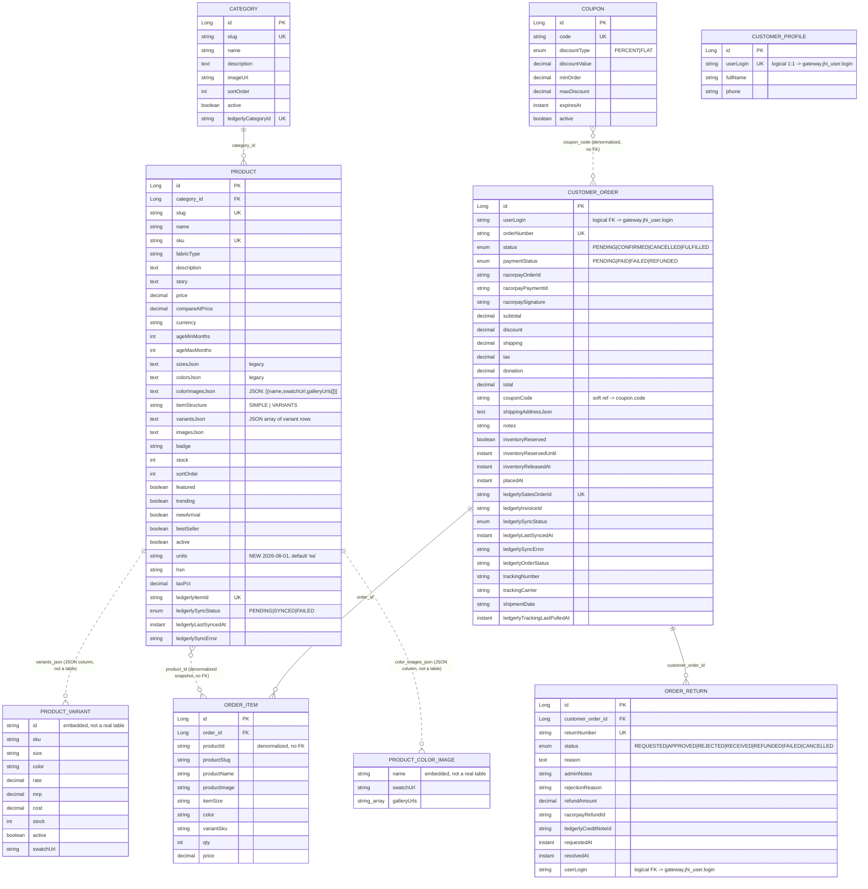
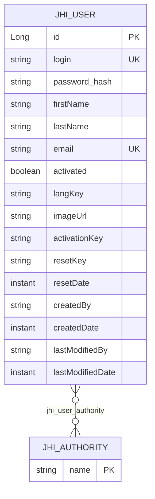
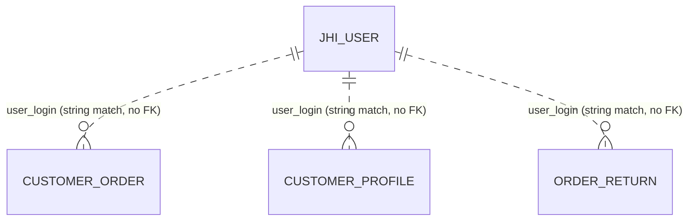

# Database ER Diagram

Two independent Postgres databases — there is **no shared schema** between them. `store` and `commerce` own no tables of their own; they proxy to `backend`, which owns the entire `miniandmore` database. See [backend-architecture.md](./backend-architecture.md) for the services and [api-schema.md](./api-schema.md) for how these entities are exposed.

| Database | Owning service | Access | Contents |
|---|---|---|---|
| `miniandmore` (5432 dev) | `backend` | JPA/Hibernate over JDBC | Catalog, orders, coupons, returns, CMS content, Ledgerly settings |
| `gateway` (5433 dev) | `gateway` | R2DBC (reactive) | Users, authorities |

Cross-database references (`user_login` columns) are **logical only** — plain strings, no enforced foreign key, since the two databases are physically separate instances.

## `miniandmore` database (backend)

### CMS / config entities (no relationships)

| Table | Key fields |
|---|---|
| `banner` | title, subtitle, imageUrl, linkUrl, ctaLabel, sortOrder, active |
| `blog_post` | slug (UK), title, excerpt, content, coverUrl, published, publishedAt |
| `home_section` | sectionKey (UK), title, subtitle, enabled, sortOrder, payloadJson |
| `page_visibility` | pageKey (UK), visible |
| `policy` | slug (UK), title, body |
| `site_setting` | singleton row: brand/contact/social/shipping/GST fields, subscribe-page copy |
| `ledgerly_setting` | singleton row: apiBaseUrl, apiToken, orgId, connected, pullProductsAutoCreateCategory, webhookSecret |
| `ledgerly_webhook_event` | eventId (UK), eventType, receivedAt — idempotency log for inbound webhooks |

### Enumerations

| Enum | Values |
|---|---|
| `DiscountType` | PERCENT, FLAT |
| `LedgerlySyncStatus` | PENDING, SYNCED, FAILED |
| `OrderReturnStatus` | REQUESTED, APPROVED, REJECTED, RECEIVED, REFUNDED, FAILED, CANCELLED |
| `OrderStatus` | PENDING, CONFIRMED, CANCELLED, FULFILLED |
| `PaymentStatus` | PENDING, PAID, FAILED, REFUNDED |

### Design note: Product variants/colors are JSON columns, not tables

`Product.variantsJson` and `Product.colorImagesJson` hold serialized JSON (parsed by the stateless helpers `ProductVariantSupport`/`ProductColorImagesSupport`), not child tables — there is no `product_variant` or `product_color_image` table in the database. The `PRODUCT_VARIANT`/`PRODUCT_COLOR_IMAGE` boxes above are shown as dotted relationships to communicate the logical 1:N shape for API/UI purposes only.

## `gateway` database

`jhi_user_authority` is a pure join table (composite PK `user_id, authority_name`), implementing the User↔Authority (role) many-to-many relationship. Only one Liquibase changelog exists for this database (`00000000000000_initial_schema.xml`) — no incremental schema evolution since.

## Cross-database logical references

These previously *were* real foreign keys back when gateway and catalog shared one database (a former monolith). Liquibase changesets `20260603120000_migrate_user_id_to_user_login.xml` and `20260606120000_drop_hybrid_order_return_user_id.xml` dropped the FK columns (`user_id`) and replaced them with plain `user_login` strings as part of the microservice split.

## Liquibase changelog history (backend, chronological)

Key milestones (full list in `backend/src/main/resources/config/liquibase/master.xml`):

1. `00000000000000_initial_schema.xml` — base JHipster schema
2. `20260522072544–072556` — initial entity generation: Category, Product, BlogPost, Banner, HomeSection, PageVisibility, SiteSetting, Policy, Coupon, CustomerProfile, CustomerOrder, OrderItem, ZohoSetting
3. `20260522081500` / `20260522092000` — Zoho sync fields, inventory reservation fields
4. `20260526–20260530` — CMS seed data and content cleanup
5. `20260602210000_added_entity_OrderReturn.xml` — adds `order_return` table + FK to `customer_order`
6. `20260603061812–061824` — a second, largely redundant "added_entity" regeneration pass (idempotent no-ops on existing tables)
7. `20260603120000_migrate_user_id_to_user_login.xml`, `20260606120000_drop_hybrid_order_return_user_id.xml` — drop legacy `user_id` FKs, add `user_login` strings (microservice split)
8. `20260701130000_rename_zoho_to_ledgerly.xml` — renames `zoho_*` → `ledgerly_*` across product/order/return/category, creates `ledgerly_setting`, drops `zoho_setting`
9. `20260701140000_ledgerly_webhook_secret.xml` — adds `ledgerly_setting.webhook_secret`, creates `ledgerly_webhook_event`
10. `20260630200000_add_tax_pct_hsn_to_product.xml` / `20260701150000_fix_tax_pct_default_to_5.xml` — GST fields on `product`
11. `20260713150000_add_customer_order_placed_at.xml`
12. `20260714150000_add_product_variants_and_order_item_variant_sku.xml` — adds `product.item_structure`, `product.variants_json`, `order_item.variant_sku`
13. **`20260801120000_add_units_to_product.xml`** (latest) — adds `product.units varchar(20)`, nullable, default `'ea'` (unit-of-measure code for Ledgerly inventory sync)

> Note: changelog execution order follows `master.xml`'s file-list order, not the timestamp embedded in each filename — a couple of entries are out of chronological order in the include list.

## Related docs

- [backend-architecture.md](./backend-architecture.md)
- [api-schema.md](./api-schema.md)
- [system-architecture.md](./system-architecture.md)
