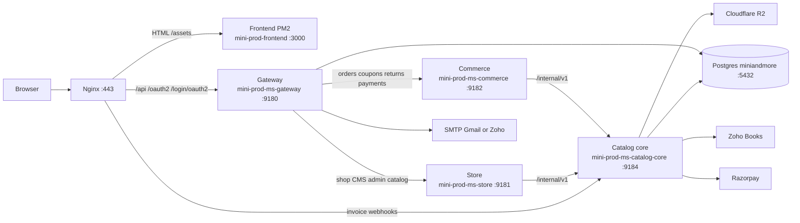

# Architecture diagram

Live production (this VPS) does **not** use Consul. Nginx talks to a local isolated stack on **9180–9184**. Catalog core is not public.

Public site: `https://minisnmore.com` and `https://www.minisnmore.com`  
TLS: Let’s Encrypt (`/etc/letsencrypt/live/minisnmore.com/`)  
Nginx site: `/etc/nginx/sites-available/mini-prod.conf`  
Locations: `deploy/nginx/prod.minisnmore.com.isolated-9180.locations.conf`

## Live process map

## Ports on this host

| Process | PM2 name | Bind | Role |
| --- | --- | --- | --- |
| Storefront + admin UI | `mini-prod-frontend` | `127.0.0.1:3000` | Vite preview of `dist/` |
| Gateway | `mini-prod-ms-gateway` | `127.0.0.1:9180` | JWT, OAuth, route `/api` |
| Store | `mini-prod-ms-store` | `127.0.0.1:9181` | Catalog/CMS/admin proxy |
| Commerce | `mini-prod-ms-commerce` | `127.0.0.1:9182` | Orders, coupons, returns, payments |
| Catalog core | `mini-prod-ms-catalog-core` | `127.0.0.1:9184` | Postgres, Zoho, Razorpay, R2 |
| Integration | *(not running)* | `:9183` if started | Optional Zoho helper; catalog can call it |

Gateway Spring profile on the live JAR: `prod,uat-isolated` (profile **name** is historical; routes point at 9181/9182/9184).

## Request examples

| Browser path | Nginx | Then |
| --- | --- | --- |
| `/`, `/shop`, `/admin`, `/product/...` | `:3000` | SPA |
| `/api/authenticate`, `/api/register` | `:9180` | Gateway itself |
| `/api/v1/categories`, `/api/v1/products`, `/api/v1/admin/products` | `:9180` → store `:9181` → catalog `:9184` | |
| `/api/v1/orders`, `/api/v1/payments`, `/api/v1/coupons`, `/api/v1/order-returns` | `:9180` → commerce `:9182` → catalog `:9184` | |
| `/oauth2/`, `/login/oauth2/` | `:9180` | Google/Apple/Facebook |
| `/api/v1/zoho/invoice-webhook` | **direct `:9184`** | Catalog (not via gateway) |
| `/internal/v1/zoho/shipment-webhook` (and item, order-status) | `:9180` | Then catalog |

Shared JWT secret: `JHIPSTER_SECURITY_AUTHENTICATION_JWT_BASE64_SECRET` in `/etc/mini-and-more/prod.env`. Every Java service must use the same value.

## Data stores

| Store | Use |
| --- | --- |
| Postgres `miniandmore` on `127.0.0.1:5432` | Catalog **and** gateway users on this host (both JDBC and R2DBC) |
| Redis `127.0.0.1:6379` | Catalog cache (`JHIPSTER_CACHE_REDIS_SERVER`) |
| Cloudflare R2 bucket `miniandmore`, prefix `prod` | Product images |
| Other `ledgerly_*` Postgres DBs | Separate Ledgerly product on this VPS — **not** Mini’s n More checkout |

Consul is **disabled** on the isolated stack (`--spring.cloud.consul.enabled=false`). Runtime Liquibase is **off**; schema is applied with `deploy/scripts/run-catalog-liquibase.sh` before a catalog JAR bounce.

## Code layout

| Folder | Service |
| --- | --- |
| `src/` | Storefront + admin (TanStack Start / React) |
| `gateway/` | Auth + routing |
| `store/` | Store edge |
| `commerce/` | Commerce edge |
| `backend/` | Catalog core (`miniandmore`) |
| `integration/` | Optional; not in the current PM2 list |
| `deploy/` | Scripts, Nginx snippets, env example |

Companion architecture write-ups: [`docs/system-architecture.md`](../system-architecture.md), [`docs/backend-architecture.md`](../backend-architecture.md), [`docs/frontend-architecture.md`](../frontend-architecture.md), [`docs/database-er-diagram.md`](../database-er-diagram.md). Those still mention 8080/Consul in places; **this handover diagram is what is actually live**.
