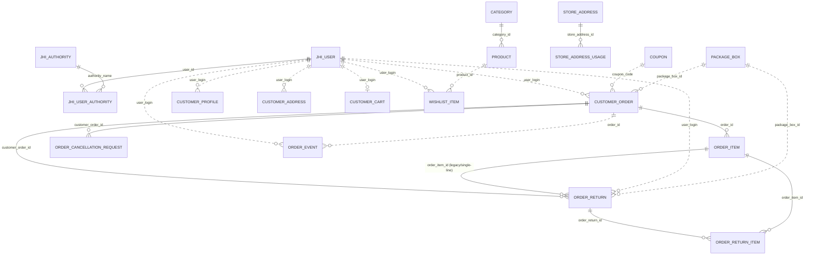
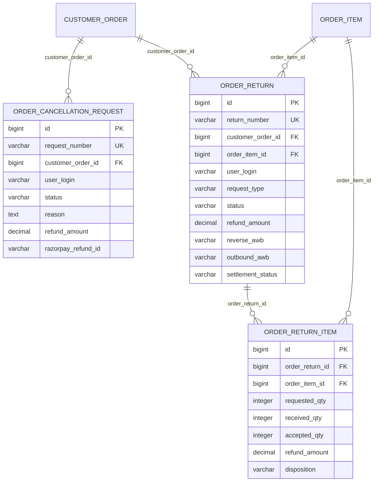
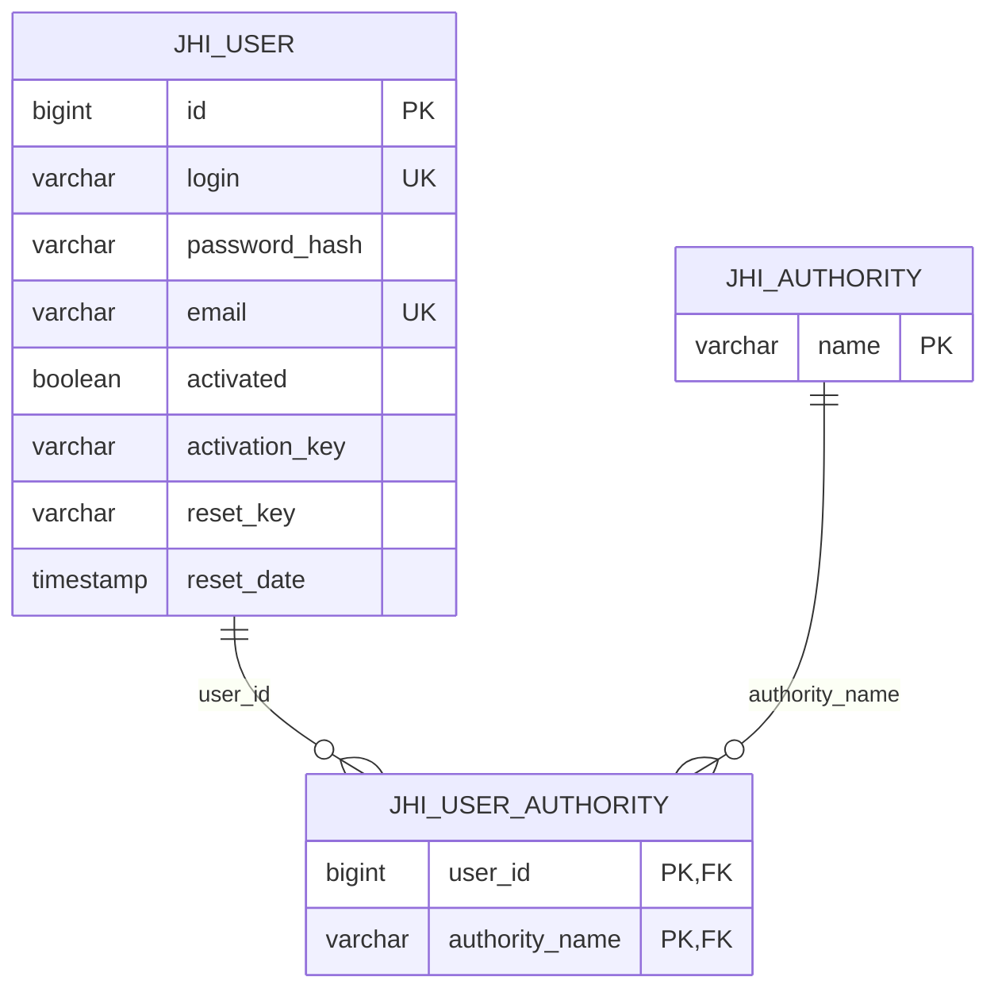

# Database schema

## Scope and source of truth

This document describes the PostgreSQL schema represented by:

- `backend/src/main/resources/config/liquibase/master.xml` and its included changelogs;
- the current JPA entity mappings under `backend/src/main/java/com/miniandmore/app/domain`; and
- the production topology documented for the isolated `9180–9184` stack.

Snapshot date: **14 October 2026**. The newest included migration is `20261014120000_add_package_short_ship_qty.xml`.

The live isolated deployment points catalog JDBC and gateway R2DBC at the same `miniandmore` database on PostgreSQL `127.0.0.1:5432`. The repository template still contains older examples with a separate `gateway` database; those are not the documented live layout.

This is a structural document, not a data export. It contains no credentials or customer records. Because the production database was not reachable while this document was generated, operators must use the verification queries at the end to confirm that every Liquibase change has been applied.

## High-level ER diagram

Solid relationships below are enforced by foreign keys. Dotted relationships are logical references stored as ids, codes, or login strings without a database foreign key.



## Core commerce schema

### `category`

| Column | Type / constraint | Purpose |
| --- | --- | --- |
| `id` | bigint PK | Internal identifier |
| `slug` | varchar(160), unique, not null | Public route key |
| `name` | varchar(160), not null | Display name |
| `description`, `image_url` | text / varchar | Content |
| `sort_order`, `active` | integer / boolean, not null | Merchandising |
| `zoho_category_id`, `ledgerly_category_id` | varchar, unique | External category mappings |

### `product`

Primary key: `id`. Foreign key: `category_id → category.id`.

| Column group | Important columns |
| --- | --- |
| Identity | `slug` unique, `name`, `sku` unique, `category_id` |
| Description | `fabric_type`, `description`, `story`, `details_kicker`, `badge` |
| Price/tax | `price`, `compare_at_price`, `currency`, `units`, `hsn`, `tax_pct` |
| Age/size | `age_min_months`, `age_max_months`, `sizes_json`, `size_chart_json`, `size_notes_json` |
| Variants/media | `item_structure`, `variants_json`, `colors_json`, `color_images_json`, `images_json`, `zoho_image_docs_json` |
| Inventory/display | `stock`, `sort_order`, `featured`, `trending`, `new_arrival`, `best_seller`, `active` |
| Zoho | `zoho_item_id` unique, `zoho_sync_status`, `zoho_last_synced_at`, `zoho_sync_error` |
| Ledgerly | `ledgerly_item_id` unique, `ledgerly_sync_status`, `ledgerly_last_synced_at`, `ledgerly_sync_error` |

Variants and color galleries are serialized JSON fields, not separate relational tables. Code must update them through the application’s parsing/validation helpers.

### `customer_order`

Primary key: `id`; business key: `order_number` unique. `user_login` is a logical reference to `jhi_user.login`.

| Column group | Important columns |
| --- | --- |
| Lifecycle | `status`, `payment_status`, `payment_method`, `placed_at`, cancellation fields |
| Money | `subtotal`, `discount`, `shipping`, `tax`, `donation`, `cod_fee`, `total`, `coupon_code` |
| Payment | `razorpay_order_id`, `razorpay_payment_id`, `razorpay_signature` |
| Customer snapshot | `user_login`, `shipping_address_json`, `notes` |
| Reservation | `inventory_reserved`, `inventory_reserved_until`, `inventory_released_at` |
| Zoho/Ledgerly | sales-order, invoice, credit-note, PDF, sync-status, error, and tracking-pull fields |
| Forward shipment | logistics mode, AWB/tracking, label, provider request/status, delivered/cancelled audit fields |
| Package | weight/dimensions, chargeable weight, courier, `package_type`, logical `package_box_id`, `packed_at` |
| Short shipment | `package_short_refund_amount`, `package_short_razorpay_refund_id` |

### `order_item`

Primary key: `id`; enforced foreign key: `order_id → customer_order.id`.

The row is an immutable order-time product snapshot: `product_id`, slug/name/image, size, color, variant SKU, ordered `qty`, `packed_qty`, unit price, MRP, HSN, tax percent, and `discount_allocation`. `product_id` is deliberately not an FK so catalog edits/deletion cannot rewrite historical orders.

### `coupon`

Primary key `id`; business key `code` unique. Supports `PERCENT`, `FLAT`, and `BOGO`, with value/minimum/maximum, buy/get quantities, eligibility scope (`ALL`, `SAME_SKU`, `CATEGORY`), optional category id, expiry, and active flag. `customer_order.coupon_code` and `eligibility_category_id` are logical references.

## Returns, exchanges, and cancellation



`order_return_item` has a unique constraint on `(order_return_id, order_item_id)`. It is the current multi-line quantity model. `order_return.order_item_id` remains for compatibility with earlier single-line return/exchange flows.

`order_return` also stores reverse-pickup and replacement-shipment provider fields, package dimensions, carrier states, QC disposition, replacement SKU/size/color, invoice/credit-note ids, exchange price settlement, restock/reservation timestamps, image evidence JSON, and manual refund audit data.

## Customer and notification tables

| Table | Keys | Purpose |
| --- | --- | --- |
| `customer_profile` | PK `id`; unique `user_login` | Name, phone, subscription flag |
| `customer_address` | PK `id`; index `user_login` | Saved delivery addresses and default flag |
| `customer_cart` | PK `id`; unique `user_login` | Cart `items_json` and optional `coupon_json` |
| `wishlist_item` | PK `id`; unique `(user_login, product_id)` | Saved product reference |
| `order_event` | PK `id`; unique event tuple | Customer notification/activity feed for orders |
| `contact_message` | PK `id`; index `created_date` | Contact form submission and timestamp |

All `user_login` links are logical string references to `jhi_user.login`, with no FK. This allows service separation but means a login rename must be handled by application logic.

## Authentication and roles



`jhi_user_authority` uses a composite primary key. Standard JHipster audit columns are present on `jhi_user`.

## Content, operations, and configuration

| Table | Business key / relationship | Purpose |
| --- | --- | --- |
| `banner` | `id`; ordered by `sort_order` | Hero image, CTA, eyebrow, and trust labels |
| `blog_post` | unique `slug` | Blog content and publish state |
| `home_section` | unique `section_key` | Configurable home/shop section JSON |
| `page_visibility` | unique `page_key` | Page feature switches |
| `policy` | unique `slug` | Policy documents |
| `site_setting` | singleton by application convention | Brand, contact, social, shipping, GST, invoice, subscription, about, gift, and policy-window settings |
| `store_address` | `id` | Operational sender/invoice addresses |
| `store_address_usage` | FK to `store_address`; unique address/usage | Multi-valued `SHIPMENT`, `NORMAL`, `INVOICE` usage |
| `package_box` | unique `name` | Reusable package dimensions and tare weight |
| `zoho_setting` | singleton by application convention | Zoho organisation/OAuth connection state and last product pull |
| `ledgerly_setting` | singleton by application convention | Ledgerly URL/token/org/connection and webhook configuration |

Secrets can exist in the integration setting tables. Database exports must therefore be encrypted and access-controlled even when environment files are excluded.

## Webhook idempotency and audit tables

Each table has `id` as its PK, `event_id` as a unique provider/idempotency key, and `received_at`.

| Table | Additional identifiers / result fields |
| --- | --- |
| `zoho_stock_webhook_event` | `sku`, `product_id` |
| `zoho_shipment_webhook_event` | Zoho sales order/number, package, shipment, status |
| `zoho_order_status_webhook_event` | Zoho sales order/number, status |
| `zoho_item_webhook_event` | Zoho item id, SKU, status |
| `zoho_invoice_webhook_event` | Zoho invoice/sales order ids, invoice number, status |
| `xpressbees_shipment_webhook_event` | order number, AWB, provider status, local status |
| `xpressbees_return_webhook_event` | return number, reverse AWB, provider status, local status |
| `razorpay_webhook_event` | event type, order number, refund id, local status |
| `ledgerly_webhook_event` | event type |

These rows are operational audit/idempotency records, not the source of truth for the order itself. The canonical state remains in `customer_order` or `order_return`.

## Main enumerated values

| Field / enum | Values |
| --- | --- |
| Order status | `PENDING`, `CONFIRMED`, `HAND_WRAPPED`, `CANCELLED`, `FULFILLED` |
| Payment status | `PENDING`, `PAID`, `FAILED`, `PARTIALLY_REFUNDED`, `REFUND_INITIATED`, `REFUND_FAILED`, `REFUNDED` |
| Return status | `REQUESTED`, `APPROVED`, `REJECTED`, `PICKUP_REQUESTED`, `PICKUP_SCHEDULED`, `PICKUP_FAILED`, `PICKED_UP`, `RECEIVED`, `INSPECTED`, `ACCEPTED`, `ITEM_ALLOCATED`, `REPACKING`, `READY_TO_SHIP`, `SHIPPED`, `DELIVERED`, `REFUNDED`, `COMPLETED`, `CANCELLED`, `FAILED` |
| Request type | `RETURN`, `EXCHANGE` |
| Logistics mode | `XPRESSBEES`, `MANUAL`, `SELF_SHIP` |
| Return disposition | `RESTOCKABLE`, `QUARANTINE`, `REPAIR`, `DISCARD`, `RETURN_TO_VENDOR` |
| Cancellation status | `REQUESTED`, `APPROVED`, `REJECTED`, `WITHDRAWN` |
| Package type | `CUSTOM`, `BOX`, `ENVELOPE` |
| Sync status | `PENDING`, `SYNCED`, `FAILED` |

## Tables managed by infrastructure

Liquibase maintains `databasechangelog` and `databasechangeloglock`. Do not edit these manually. The base JHipster changelog may also create `jhi_date_time_wrapper` for framework/test support; it is not a business table.

## Production verification queries

Run with a read-only or appropriately restricted PostgreSQL account. Do not paste credentials into shell history.

```sql
-- Schema version and most recently executed changes
SELECT id, author, filename, dateexecuted, orderexecuted
FROM databasechangelog
ORDER BY orderexecuted DESC
LIMIT 20;

-- Expected application tables
SELECT table_name
FROM information_schema.tables
WHERE table_schema = 'public'
ORDER BY table_name;

-- Enforced foreign keys
SELECT
    tc.constraint_name,
    tc.table_name,
    kcu.column_name,
    ccu.table_name AS referenced_table,
    ccu.column_name AS referenced_column
FROM information_schema.table_constraints tc
JOIN information_schema.key_column_usage kcu
  ON tc.constraint_name = kcu.constraint_name
 AND tc.constraint_schema = kcu.constraint_schema
JOIN information_schema.constraint_column_usage ccu
  ON ccu.constraint_name = tc.constraint_name
 AND ccu.constraint_schema = tc.constraint_schema
WHERE tc.constraint_type = 'FOREIGN KEY'
  AND tc.table_schema = 'public'
ORDER BY tc.table_name, tc.constraint_name;

-- Column-level definition for any table
SELECT ordinal_position, column_name, data_type, is_nullable, column_default
FROM information_schema.columns
WHERE table_schema = 'public' AND table_name = 'customer_order'
ORDER BY ordinal_position;
```

Expected latest change id: confirm the change from `20261014120000_add_package_short_ship_qty.xml` appears in `databasechangelog`. Runtime Liquibase is disabled in production, so a missing change must be applied through `deploy/scripts/run-catalog-liquibase.sh` during an approved deployment; do not patch production tables manually.
