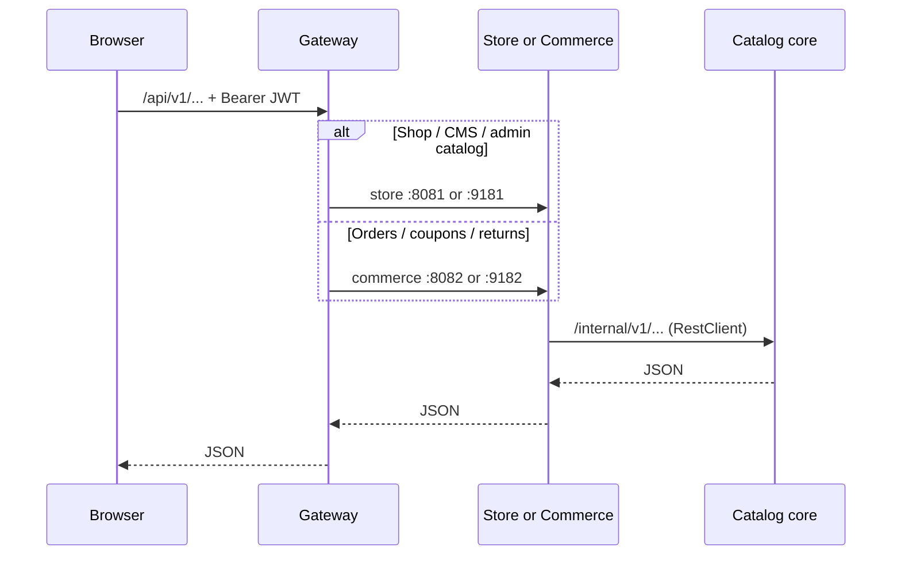

# Microservices architecture (JHipster 9)

| App | Folder | Dev port | Prod port | Role |
| --- | --- | --- | --- | --- |
| **Gateway** | `services/gateway/` | 8080 | **9180** | JWT, OAuth2, Spring Cloud Gateway |
| **Catalog core** | `backend/` | 8084 | **9184** | Domain DB, Ledgerly, internal APIs |
| **Store** | `services/store/` | 8081 | **9181** | Storefront + admin CMS proxy |
| **Commerce** | `services/commerce/` | 8082 | **9182** | Orders, profile, coupons, returns |

Users and authentication live on the **gateway**. Catalog core stores `userLogin` on orders and profiles.

## Request flow

## Local development

See [LOCAL_DEV.md](./LOCAL_DEV.md). Vite proxies `/api` to gateway `:8080`.

## JWT

Shared `jhipster.security.authentication.jwt.base64-secret` on gateway, catalog core, store, and commerce.

## Testing

[MODULES_TESTING.md](./MODULES_TESTING.md) · [ledgerly-integration-test-scenarios.md](./ledgerly-integration-test-scenarios.md) · [FRONTEND_API_CONTRACT.md](./FRONTEND_API_CONTRACT.md)

## Rules

[pure-microservices.md](./pure-microservices.md)

## URLs

| URL | Description |
| --- | --- |
| http://localhost:8080 | Gateway (dev) |
| http://localhost:8500 | Consul UI (dev) |
| https://minisnmore.com/api/ | Public API (production → :9180) |

Full topology: [system-architecture.md](./system-architecture.md) · [handover/architecture-diagram.md](./handover/architecture-diagram.md)
