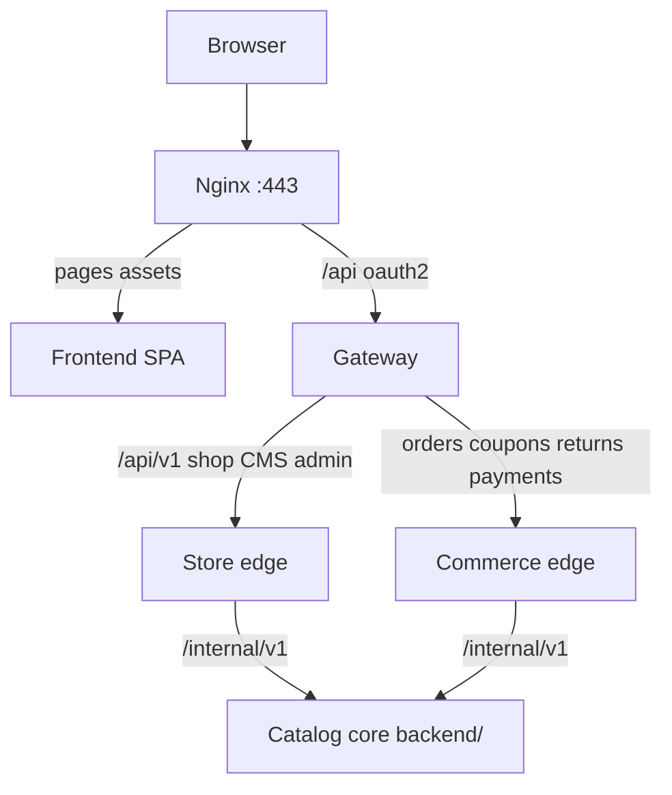

# System Architecture

Mini's n More is a **JHipster microservice backend** (gateway + store + commerce + catalog core) behind a single **TanStack Start** storefront and admin UI under `frontend/`.

Companion docs: [frontend-architecture.md](./frontend-architecture.md), [backend-architecture.md](./backend-architecture.md), [database-er-diagram.md](./database-er-diagram.md), [api-schema.md](./api-schema.md), [production topology](./handover/architecture-diagram.md).

## Services

| Service | Folder | Dev port | Production port | Role |
| --- | --- | --- | --- | --- |
| **Frontend** | `frontend/` | 5173 (Vite) | 3000 (PM2 preview) | Storefront + admin CMS |
| **Gateway** | `services/gateway/` | 8080 | **9180** | JWT, OAuth2, Spring Cloud Gateway |
| **Store** | `services/store/` | 8081 | **9181** | Shop + admin CMS proxy → catalog core |
| **Commerce** | `services/commerce/` | 8082 | **9182** | Orders, profile, coupons, returns → core |
| **Catalog core** | `backend/` (`miniandmore`) | 8084 | **9184** | Domain DB, Ledgerly, Razorpay, R2, internal APIs |

`store` and `commerce` have **no database** — they validate JWT and forward to catalog core over a fixed `CATALOG_BASE_URL` (`RestClient`, not Feign).

## Request flow (logical)



### Local development

```text
Browser → Vite :5173 (proxies /api → Gateway :8080)
  → Gateway (Consul lb://miniandmore-store | miniandmore-commerce)
      → Store :8081 | Commerce :8082
          → Catalog core :8084 (127.0.0.1)
```

### Production (minisnmore.com)

```text
Browser → Nginx :443
  → Frontend PM2 :3000 (HTML/JS)
  → Gateway PM2 :9180 (profile prod,uat-isolated — Consul OFF)
      → Store :9181 | Commerce :9182 (fixed HTTP, not lb://)
          → Catalog core :9184 (loopback only)
```

Some webhooks hit catalog core **directly** on `:9184` (e.g. invoice callback) or via gateway routes to `:9184`; see [handover/architecture-diagram.md](./handover/architecture-diagram.md).

## Authentication

- JWT is issued only on the **gateway** (`POST /api/authenticate`, register, OAuth2).
- `JWTRelayGatewayFilterFactory` forwards the bearer token to store/commerce.
- Every Java service validates the same HMAC secret: `JHIPSTER_SECURITY_AUTHENTICATION_JWT_BASE64_SECRET`.
- Edge → core may also send `application.internal-api-key` (`INTERNAL_API_KEY`).

## Databases and cache

| Database | Typical dev | Production (this VPS) | Owner | Contents |
| --- | --- | --- | --- | --- |
| `miniandmore` | `:5432` | `:5432` | catalog core | Products, orders, CMS, Ledgerly settings |
| `gateway` | `:5433` | often same host DB | gateway (R2DBC) | `jhi_user`, roles |

Cross-DB `user_login` references are **logical strings**, not foreign keys.

**Redis** (`127.0.0.1:6379`) — catalog cache. **Cloudflare R2** — product images (`application.storage.s3.*`).

## External systems

| System | Where integrated | Purpose |
| --- | --- | --- |
| **Ledgerly** | catalog core | Product/order sync, inventory pull, webhooks `/internal/v1/ledgerly/webhooks` |
| **Razorpay** | catalog core | Payments and refunds |
| **XpressBees** | catalog core | Shipment / return webhooks |
| **Google / Apple / Facebook OAuth** | gateway | Social login |
| **SMTP** | gateway / mail config | Transactional email |
| **Zoho Books paths** | catalog core (legacy routes) | Legacy webhook URL compatibility; admin Zoho settings where still enabled |

## Discovery and config

| Environment | Consul | Gateway → edge routing |
| --- | --- | --- |
| Local dev | On (`:8500`) | `lb://miniandmore-store`, `lb://miniandmore-commerce` |
| Production isolated stack | **Disabled** | Fixed `http://127.0.0.1:9181` / `9182` / `9184` in `application-uat-isolated.yml` |

## Code layout

| Path | Service |
| --- | --- |
| `frontend/src/` | React storefront + admin |
| `services/gateway/` | Auth + routing |
| `services/store/` | Store edge |
| `services/commerce/` | Commerce edge |
| `backend/` | Catalog core |
| `deploy/` | Nginx, PM2, env examples, release scripts |

## Operations pointers

- Production ports and PM2 names: [PRODUCTION_READINESS.md](./PRODUCTION_READINESS.md), [deploy/scripts/README.md](../deploy/scripts/README.md).
- Schema: Liquibase in `backend/`; production applies via `deploy/scripts/run-catalog-liquibase.sh` before catalog JAR restart when needed.
- Reports site embeds these diagrams: run `python3 jenkins/scripts/generate-architecture-report.py` (wired from `generate-reports-site.py`).
