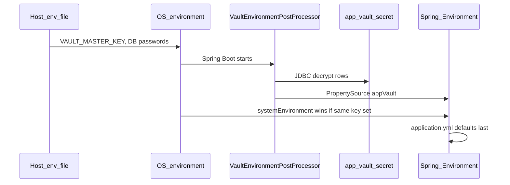

# Application secrets vault

This document describes how runtime secrets are stored, loaded, rotated, and operated in UAT/production.

## What problem it solves

Historically, almost every secret lived in `/etc/mini-and-more/*.env` on the server. That file is easy to leak via backups, support tickets, or broad filesystem access.

We now have **two layers**:

1. **Host env file encrypted at rest** — `/etc/mini-and-more/prod.env.enc` (AES-256-CBC + PBKDF2), unlocked by `/etc/mini-and-more/env.key`. Deploy scripts decrypt to a temp file, `source` it, then shred the temp. Plaintext `prod.env` should not remain on disk after encryption.
2. **Application vault in Postgres** — most runtime secrets in `app_vault_secret` (AES-GCM), unlocked by `VAULT_MASTER_KEY` (which lives *inside* the encrypted host env file).

So: steal a disk snapshot of `prod.env.enc` without `env.key` → useless. Steal `env.key` + `.enc` → can read bootstrap secrets; vault ciphertext still needs `VAULT_MASTER_KEY` from that file.

## Host env file encryption

| Path | Purpose |
|------|---------|
| `/etc/mini-and-more/prod.env.enc` | Encrypted host env (canonical) |
| `/etc/mini-and-more/env.key` | Passphrase for OpenSSL decrypt (chmod 600) — **back up offline** |
| `/etc/mini-and-more/prod.env` | Plaintext — only while editing; remove after encrypt |

```bash
# First time (or after editing plaintext):
sudo ./deploy/scripts/env-file-encrypt.sh /etc/mini-and-more/prod.env
# → prod.env.enc + env.key; shreds plaintext

# Edit later:
sudo ./deploy/scripts/env-file-decrypt.sh /etc/mini-and-more/prod.env.enc
# edit /etc/mini-and-more/prod.env
sudo ./deploy/scripts/env-file-encrypt.sh /etc/mini-and-more/prod.env
```

UAT: same with `uat.env` → `uat.env.enc` (same `env.key` directory).

Deploy scripts call `load_mini_env` / `mini_load_host_env` and prefer `.enc` when present.

Zoho OAuth **client secret** and **refresh token** are stored separately in `zoho_setting` (admin UI: **Zoho settings**). Those columns are also encrypted with the same master key via JPA. Ledgerly DB columns are **not** encrypted by this feature.

## Components

| Piece | Location | Role |
|-------|----------|------|
| `vault-bootstrap` | `services/vault-bootstrap/` | Shared JAR: AES-GCM crypto, JDBC loader, Spring `EnvironmentPostProcessor` |
| `app_vault_secret` | Catalog Postgres | One row per env var name (`JHIPSTER_SECURITY_…`, `RAZORPAY_KEY_SECRET`, etc.) |
| `VAULT_MASTER_KEY` | Host env only | 32-byte AES key, base64-encoded (`openssl rand -base64 32`) |
| `VAULT_JDBC_*` | Host env (gateway/store/commerce) | JDBC URL/user/password to **catalog** DB (not gateway DB) |
| Admin API / UI | `/api/v1/admin/vault`, `/admin/vault` | List/set/remove secrets (never returns plaintext on GET) |
| Zoho encryption | `zoho_setting.client_secret`, `refresh_token` | JPA `EncryptedStringAttributeConverter` |

## Cryptography

- **Algorithm:** AES-256-GCM
- **Wire format:** `v1:` + base64(12-byte IV || ciphertext || auth tag)
- **Master key:** Must decode to exactly 32 bytes

Tampering or wrong key causes decryption to fail at startup or on read.

## How secrets are loaded at runtime



**Precedence (highest first):**

1. Command-line / JVM `-D` properties  
2. OS environment (`prod.env` exported variables)  
3. **Vault** (`app_vault_secret` decrypted)  
4. `application.yml` defaults  

So you can still emergency-override a vault value by setting the real env var on the host.

Every Java service (catalog, gateway, store, commerce) depends on `vault-bootstrap` and registers the same post-processor.

### Bootstrap-only keys (never stored in vault)

- `VAULT_MASTER_KEY`
- `SPRING_DATASOURCE_*`, `SPRING_R2DBC_*`, `SPRING_LIQUIBASE_*`
- `VAULT_JDBC_*`

Enforced in `VaultBootstrapDenylist` and `deploy/scripts/vault-import-env.sh`.

## Build and deploy

1. Install shared module (required before other Java builds):

   ```bash
   (cd services/vault-bootstrap && ./mvnw install)
   ```

2. Run Liquibase on **catalog** (creates `app_vault_secret`, widens `zoho_setting` secret columns).

3. On each host, create plaintext env once, then encrypt:

   ```bash
   # Edit /etc/mini-and-more/prod.env (chmod 600) with at least:
   VAULT_MASTER_KEY=<openssl rand -base64 32>
   SPRING_DATASOURCE_URL=...
   SPRING_DATASOURCE_USERNAME=...
   SPRING_DATASOURCE_PASSWORD=...
   VAULT_JDBC_URL=jdbc:postgresql://127.0.0.1:5432/miniandmore
   VAULT_JDBC_USERNAME=...
   VAULT_JDBC_PASSWORD=...

   sudo ./deploy/scripts/env-file-encrypt.sh /etc/mini-and-more/prod.env
   # now only prod.env.enc + env.key remain — back up env.key offline
   ```

4. Import secrets (after deploy + admin login):

   ```bash
   ADMIN_JWT=<admin token> BASE_URL=https://uat.minisnmore.com \
     ./deploy/scripts/vault-import-env.sh /etc/mini-and-more/uat.env
   ```

5. **One-time Zoho plaintext migration** (if rows already existed):

   ```bash
   VAULT_MIGRATE_ZOHO_PLAINTEXT=true
   ```

   Restart catalog once, then set back to `false`.

6. **Restart all four JVMs** (gateway, store, commerce, catalog) after any vault change.

7. Optionally remove imported keys from the env file (keep bootstrap keys only).

### Read-only DB role (recommended)

Use a dedicated Postgres role for `VAULT_JDBC_*` with `SELECT` on `app_vault_secret` only. Example: [`deploy/sql/vault-readonly-role.sql`](../deploy/sql/vault-readonly-role.sql).

## Admin operations

- **UI:** Admin → **Env vault** — filter keys, paste new values, Save (restart reminder shown).
- **API:** `GET/PUT/DELETE /api/v1/admin/vault`, `POST /import` (ADMIN role).
- **Zoho OAuth:** Admin → **Zoho settings** (not the env vault list for client/refresh tokens).

## Master key rotation

Rotation re-encrypts all `app_vault_secret` rows and Zoho secret columns **in the database** using a new key. You must then update `VAULT_MASTER_KEY` on every server and restart all services.

### Option A — Admin API (catalog running with current key)

1. Generate new key: `NEW=$(openssl rand -base64 32)`
2. Call (**SUPER_ADMIN** JWT only, maintenance window):

   ```bash
   curl -fsS -X POST "$BASE_URL/api/v1/admin/vault/rotate-master-key" \
     -H "Authorization: Bearer $SUPER_ADMIN_JWT" \
     -H "Content-Type: application/json" \
     -d "{\"newMasterKey\":\"$NEW\"}"
   ```

3. Update host env (`prod.env.enc` / `uat.env.enc`) on **all** hosts: `VAULT_MASTER_KEY=$NEW`
4. Restart gateway, store, commerce, catalog.

### Option B — Export / import (if API unavailable)

1. With old key in place, export secrets to an encrypted offline file (your procedure; do not commit).
2. Set new `VAULT_MASTER_KEY` on hosts.
3. Re-run `vault-import-env.sh` with plaintext map or admin import.
4. Re-save Zoho credentials in admin (or run Zoho migration after temporarily loading old key).

### Option C — Script

See [`deploy/scripts/vault-rotate-master-key.sh`](../deploy/scripts/vault-rotate-master-key.sh) (wraps the admin API).

**Never** store old and new master keys in git. Rotate during a maintenance window; a wrong key bricks decryption until restored from backup or re-import.

## Failure modes

| Symptom | Likely cause |
|---------|----------------|
| Startup: `has N row(s) but no secrets were loaded` | `VAULT_JDBC_*` points at wrong database |
| Zoho OAuth fails after encrypting DB | Catalog started without `VAULT_MASTER_KEY` |
| Secret change has no effect | Services not restarted after vault edit |
| Prod validator: master key required | `app_vault_secret` has rows, or Zoho ciphertext, but no key |

## Security notes

- Vault admin APIs are as sensitive as root credentials; protect ADMIN accounts and use TLS.
- OS env still overrides vault — intentional for break-glass.
- `POST /import` requires ADMIN; `rotate-master-key` requires **SUPER_ADMIN** only.
- Backups of Postgres now contain ciphertext; protect backups and master key separately.

## Related files

- `services/vault-bootstrap/` — crypto + loader
- `backend/.../VaultSecretService.java`, `VaultAdminResource.java`
- `deploy/env/uat.env.example`, `deploy/env/prod.env.example`
- `deploy/scripts/vault-import-env.sh`, `vault-rotate-master-key.sh`
